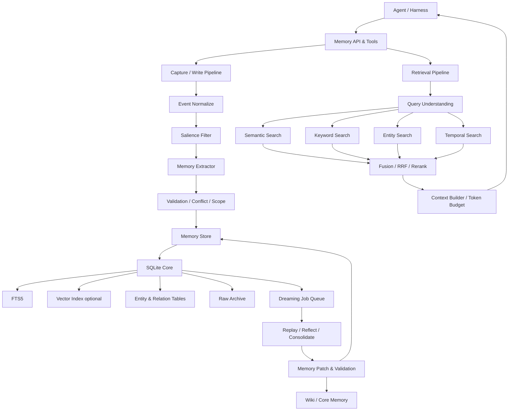

# AI Agent Memory Engine：可落地技术设计

> Version 1.0 | 2026-11-22 | Architecture proposal

## 1. 目标与原则

Memory 不应等同于聊天摘要或向量数据库。它是 Agent 的持久化认知层，负责捕获经历、提取信息、管理事实与经验、跨会话检索、维护知识并将相关内容组装到当前 Context。

设计目标：减少重复探索；跨 session/task/project 延续工作；处理事实变化与矛盾；可追溯来源；成本可控；支持用户查看、修正、删除；隔离不同用户、Agent、项目与任务的记忆；底层索引可重建。

核心原则：
- 原始事件不可变，派生 Memory 可更新且保留版本。
- Memory Type 与 Storage Tier 分离。
- 主存储采用 SQLite；FTS/向量/图是索引或可重建能力，不是唯一事实源。
- 同步路径轻量，复杂整理走异步 Dreaming。
- 事实、可信度、重要性、稳定性、权限、时效各自独立建模。
- 不将外部文档中的指令自动转成 Agent 指令；Memory 是数据，不是更高优先级的 Prompt。
- Context Builder 根据任务相关性与 Token Budget 选择内容，不全量加载。

## 2. 参考设计与借鉴

### Anthropic Components of Agent Memory
参考：<https://www.anthropic.com/research/components-of-agent-memory>
层级包括 Transcripts（可搜索的原始事件）、Memory Notes（会话中记录的显著内容）、Memory Representations（Wiki/主题知识/链接）与 Injected Context（每次会话预加载的少量信息）。Dreaming 可回放事件、纠错、合并笔记、构建 Wiki、修复链接、晋升或降级记忆。其研究强调保持注入层小、Wiki 与搜索结合、后台整理可弥补即时写入的局限。建议采用其层级和 Dreaming 概念，但实现可审计的 Patch/Version 流程。

### MindStudio Claude Dreaming 解读
参考：<https://www.mindstudio.ai/blog/what-is-claude-dreaming-anthropic-agent-memory>
将 Dreaming 理解为离线/后台整理，不只做定时总结：从历史会话提取规律，重整知识结构，更新未来可用的记忆。本文作为概念参考，关键技术以原始 Anthropic 研究为准。

### MemGPT / Letta
参考：<https://github.com/letta-ai/letta>
借鉴有限 Context 与外部记忆之间的虚拟分页、Agent 可主动读写记忆块、工具化记忆管理。不要完全依赖 Agent 主动写入，需补充自动提取与后台整理。

### Mem0
参考：<https://github.com/mem0ai/mem0>
借鉴候选事实提取、去重、更新、删除、按用户/Agent/任务作用域管理。Memory 不应只是对话 Chunk；应成为可维护的独立事实/经验对象。

### Zep / Graphiti
参考：<https://github.com/getzep/graphiti> 及论文 <https://blog.getzep.com/content/files/2025/01/ZEP__USING_KNOWLEDGE_GRAPHS_TO_POWER_LLM_AGENT_MEMORY_2025011700.pdf>
借鉴时序知识图谱：实体关系、事实来源、有效时间、历史状态与新旧事实替代。初期不必部署 Graph DB，可用 SQLite relation tables。

### Generative Agents
参考：<https://arxiv.org/abs/2304.03442>
借鉴 Memory Stream、检索、反思：事件按时间保存，召回结合相关性、重要性和近期性，Reflection 从多个经历中归纳更高阶经验。

### LangGraph / LangMem
参考：<https://github.com/langchain-ai/langgraph>、<https://github.com/langchain-ai/langmem>
借鉴短期 Thread/Run state 与跨会话长期 Memory 分离。Checkpoint 是任务恢复状态，不应与长期记忆混用。

## 3. 总体架构



六个子系统：Capture、Write/Extraction、Retrieval、Context Builder、Dreaming、Governance。

## 4. Memory Types 与 Storage Tiers

### Memory Types
- `working`：当前任务目标、计划、假设、临时结果、待办；任务结束可归档为 Episode。
- `episodic`：一次任务/事件经历，包含问题、行动、结果、失败原因、时间。
- `semantic`：稳定事实、用户偏好、技术栈、业务规则、实体事实。
- `procedural`：可复用步骤、操作流程、故障处理、开发方法；应有证据与成功率。
- `project`：项目架构、决策、约束、进展、模块知识。
- `reflective`：从多个 Episode 总结的规律、策略与教训。
- `reference`：文档/Wiki/代码/手册的索引和引用；大内容按需加载。

### Storage Tiers
- L0 Working Context：当前 Run/Task state，动态、可覆盖，不默认长期化。
- L1 Core Memory：每次 Session 少量注入，偏好、约束、活跃项目索引；建议预算 1k–2.5k tokens。
- L2 Memory Store：事实、Episode、Procedure、Project、Reflection，按需检索。
- L3 Archive：完整 Transcript、Tool Call/Result、执行日志、原始文件等；作为证据源，搜索/按需加载。

Type 是内容类别；Tier 是保存和加载策略，两者不要混为一谈。


## 5. Write Pipeline

采用三条写入通道：
1. Explicit Write：用户明确说“记住”、重要纠正或 Agent 主动保存关键经验；快速写入，但仍检查权限/敏感内容。
2. Auto Extraction：Session/Task 阶段结束时自动提取候选。
3. Dreaming：跨 Session 后台合并、修正、关联、晋升/降级。

流程：Event Capture → Normalize → Rule Filter → Salience Scoring → Candidate Extraction → Scope/Trust Check → Entity Resolution → Duplicate/Conflict Detection → Commit or Pending.

Event 不可被 Extraction 覆写。Candidate 是派生对象，须包含 Evidence Event IDs。

### Event schema 示例
```json
{
  "event_id":"evt_01",
  "tenant_id":"default",
  "owner_id":"user_1",
  "agent_id":"agent_main",
  "session_id":"session_1",
  "task_id":"task_1",
  "event_type":"conversation|tool|task|feedback|observation",
  "source":"conversation",
  "role":"user",
  "content":"项目数据库已从 PostgreSQL 迁移到 SQLite",
  "occurred_at":"2026-11-22T10:00:00+08:00",
  "captured_at":"2026-11-22T10:00:01+08:00",
  "importance_hint":0.8,
  "metadata":{}
}
```

### Salience Filter
Rule-first：排除问候、重复工具输出、无复用价值的一次性查询、临时状态、未经许可的敏感信息；提升明确记忆请求、用户纠正、稳定偏好、项目决策、已验证解决方案、可复用经验。

Candidate Extraction 输出结构化对象：type/category、subject/predicate/object、content、scope、importance、confidence、durability、reusability、explicit、evidence IDs、source trust。

### Scoring (initial heuristic)
`S = 0.25*Importance + 0.20*Reusability + 0.15*Durability + 0.15*Confidence + 0.15*Utility + 0.10*Explicitness`
初始阈值建议：≥0.80 高价值候选；0.60–0.79 普通长期候选；0.40–0.59 Episode/低优先级；低于 0.40 不提取或仅保留原始事件。阈值是可调工程参数，Explicit Memory 可绕过重要性阈值，但不可绕过安全/权限规则。评分不能代替事实验证。

## 6. Retrieval Pipeline

不要只用向量搜索。四路召回：
- Semantic：Embedding 相似度，召回概念相关经验。
- Keyword：SQLite FTS5/BM25，适合错误码、路径、标识符、命令。
- Entity：实体、别名、关系、项目名称。
- Temporal：当前事实、历史事实、指定时间范围。

流程：Query Understanding（实体、关键词、项目、时间、意图、Memory Type）→ Scope Filter → 并行召回 → 去重 → Fusion → Rerank → Evidence/Temporal Check → Context Builder。

建议候选规模起点：Semantic Top 20、Keyword Top 20、Entity Top 10、Temporal Top 10；合并去重后排序。数量应通过评测调优。

RRF：`RRF(d) = Σ_i w_i / (k + rank_i(d))`，k 可从 60 开始。融合后可按相关性、可信度、时效、效用、重要性和 Scope 匹配二次排序。初始权重仅为实验参数，不是固定真理。

Scope hierarchy：global / user / agent / project / repository / session / task。默认优先当前 Task、Session、Repository、Project、User、Agent Global；禁止无条件跨 Project 召回。跨 Scope 结果需有明确关联或授权。

## 7. Context Builder

Context 结构：System Prompt → Core Memory → Current Task State → Retrieved Memory → External References。Search Result 不直接全部塞 Prompt；Context Builder 做去重、排序、Token Budget、引用/来源保留。

预算初值：Core 1k tokens；Task State 1k–3k；Retrieved Memory 2k–6k；Procedure 1k–3k；Reference 0–10k（按需）；总 Memory Budget 5k–12k，可配置。Coding Agent 应提高当前 Project Memory 权重，降低无关全局偏好。
Core Memory 示例：用户偏好、Global Rules、Active Projects、每项目短摘要和 Memory Index。保持小而稳定（建议 100–200 行内），详细信息指向 L2。

## 8. Dreaming Engine

Dreaming 是后台 Memory Maintenance，而不是每日对话总结。目标：Replay、Analyze、Consolidate、Represent、Validate、Commit。

### Triggers
- Task Completion：生成 Episode。
- Session End：整理近期会话。
- Event Threshold：达到新事件数量。
- Memory Threshold：重复率/存量超阈值。
- Scheduled：每日轻量、每周深度。
- Retrieval Feedback：多次有用记忆晋升候选。
- Conflict Event：事实矛盾时触发验证。
- Manual：用户指定主题整理。

建议初始：Task 完成轻量 Episode；每 10–30 个新 Event 批量 Consolidation；每日轻量 Dream；每周深度 Dream。频率根据活跃度、费用与数据量调节。

### Dream Pipeline
1. Replay：读取新增事件、Episode、候选、相关现有记忆。
2. Analyze：识别重复、变化、冲突、模式、失败与知识缺口。
3. Consolidate：Merge、Update、Create、Invalidate、关系更新。
4. Represent：更新 Topic/Wiki/Entity Graph/Core Memory。
5. Validate：来源检查、引用检查、时序、断链、权限与安全检查。
6. Commit：生成 Patch，自动批准或人工审核后提交。

### Patch-first
Dreaming 不直接覆盖正式 Memory。Patch 字段包括 operation、target IDs、proposed content、reason、evidence、risk、status。低风险新增/重复合并/索引修复可自动批准；重大事实反转、删除重要记忆、跨 Scope 移动需要更严格策略。提交时保存旧版本并写 Audit，可回滚。

初期单 Dreaming Coordinator，内部按 Analyzer、Consolidator、Knowledge Builder、Verifier 阶段执行；不必部署多 Agent。按 Scope 分区并发，单 Scope 写入串行化或使用乐观锁。

## 9. SQLite Storage

第一阶段 SQLite-first，FTS5 必须，Vector Index 可选（如 sqlite-vec 或可替换实现），Embedding Provider 可本地或远端。Entity Graph 使用关系表，无需早期部署 Graph DB。原始 Archive 可用 SQLite 与文件存储组合。

核心表：
- `memory_events`：不可变原始事件。
- `memory_candidates`：提取待审候选。
- `memories`：当前记忆。
- `memory_versions`：版本历史。
- `memory_sources`：记忆与证据关联。
- `memory_entities`：实体与别名。
- `memory_relations`：实体/记忆关系。
- `memory_topics`、`memory_topic_links`：Wiki/主题结构。
- `memory_embeddings`：模型版本、向量、维度。
- `memory_usage`：召回、注入、使用、反馈。
- `memory_jobs`：Extract/Dream/Reindex 等后台任务。
- `memory_core`：Core Memory。
- `memory_audit`：审计记录。

### memories fields
id, tenant_id, owner_id, agent_id, scope_type, scope_id, memory_type, category, title, content, summary, importance, confidence, durability, status, valid_from, valid_until, created_at, updated_at, last_accessed_at, access_count, superseded_by, canonical_id, metadata。
Status：pending, active, superseded, archived, invalidated, deleted。Memory type 用可扩展字符串，不硬编码 DB ENUM。


### SQL starter schema
```sql
CREATE TABLE memories (
  id TEXT PRIMARY KEY,
  tenant_id TEXT NOT NULL,
  owner_id TEXT NOT NULL,
  agent_id TEXT,
  scope_type TEXT NOT NULL,
  scope_id TEXT,
  memory_type TEXT NOT NULL,
  category TEXT,
  title TEXT,
  content TEXT NOT NULL,
  summary TEXT,
  importance REAL DEFAULT 0.5,
  confidence REAL DEFAULT 0.5,
  durability REAL DEFAULT 0.5,
  status TEXT NOT NULL DEFAULT 'active',
  valid_from TEXT,
  valid_until TEXT,
  created_at TEXT NOT NULL,
  updated_at TEXT NOT NULL,
  last_accessed_at TEXT,
  access_count INTEGER DEFAULT 0,
  superseded_by TEXT,
  canonical_id TEXT,
  metadata TEXT
);

CREATE TABLE memory_events (
  id TEXT PRIMARY KEY,
  tenant_id TEXT NOT NULL,
  owner_id TEXT NOT NULL,
  agent_id TEXT,
  session_id TEXT,
  task_id TEXT,
  event_type TEXT NOT NULL,
  source_type TEXT NOT NULL,
  role TEXT,
  content TEXT NOT NULL,
  occurred_at TEXT,
  captured_at TEXT NOT NULL,
  importance_hint REAL,
  processed_status TEXT DEFAULT 'pending',
  metadata TEXT
);

CREATE TABLE memory_versions (
  id TEXT PRIMARY KEY,
  memory_id TEXT NOT NULL,
  version INTEGER NOT NULL,
  content TEXT NOT NULL,
  summary TEXT,
  changed_by TEXT,
  change_reason TEXT,
  change_type TEXT,
  created_at TEXT NOT NULL,
  FOREIGN KEY(memory_id) REFERENCES memories(id)
);

CREATE TABLE memory_sources (
  id TEXT PRIMARY KEY,
  memory_id TEXT NOT NULL,
  event_id TEXT,
  source_type TEXT,
  source_ref TEXT,
  evidence_text TEXT,
  evidence_hash TEXT,
  confidence REAL,
  created_at TEXT,
  FOREIGN KEY(memory_id) REFERENCES memories(id)
);

CREATE TABLE memory_entities (
  id TEXT PRIMARY KEY,
  owner_id TEXT NOT NULL,
  entity_type TEXT NOT NULL,
  canonical_name TEXT NOT NULL,
  aliases TEXT,
  description TEXT,
  metadata TEXT,
  created_at TEXT,
  updated_at TEXT
);

CREATE TABLE memory_relations (
  id TEXT PRIMARY KEY,
  source_entity_id TEXT NOT NULL,
  target_entity_id TEXT NOT NULL,
  relation_type TEXT NOT NULL,
  memory_id TEXT,
  confidence REAL,
  valid_from TEXT,
  valid_until TEXT,
  metadata TEXT,
  created_at TEXT
);

CREATE VIRTUAL TABLE memories_fts USING fts5(
  title, content, summary, tokenize='unicode61'
);

CREATE TABLE memory_embeddings (
  memory_id TEXT NOT NULL,
  model_name TEXT NOT NULL,
  model_version TEXT NOT NULL,
  dimensions INTEGER NOT NULL,
  embedding BLOB NOT NULL,
  created_at TEXT NOT NULL,
  PRIMARY KEY(memory_id, model_name, model_version)
);
```

**Schema corrections before implementation:** the starter above intentionally illustrates field choices but contains three `PRIMARY PRIMARY KEY` typos in events/versions/sources/entities; replace with `id TEXT PRIMARY KEY` before executing. Use migrations, indexes, foreign keys, WAL, Busy Timeout, and transaction discipline. FTS triggers/app-layer transaction should keep FTS in sync. Vector index is rebuildable; main fact/source/time/permission data remains SQLite truth.

## 10. Memory API / Tools

Internal API + Agent Tools + optional MCP + admin APIs. Tools:
- `memory_search(query, scope, types, time_range, limit)`
- `memory_get(memory_id)`
- `memory_remember(content, type, scope, importance, reason)`
- `memory_update(memory_id, content, reason, evidence)`
- `memory_forget(memory_id, mode)`
- `memory_feedback(memory_id, helpful|irrelevant|stale|incorrect)`
- `memory_pin(memory_id)` / `memory_unpin(memory_id)`
- `memory_core_get()`
- `memory_dream_run(scope, topic)` (admin/user permission gated)
- `memory_stats()`
Agent never directly runs SQL; all operations enforce scope, policy, audit, and provenance.

## 11. Job System

Job types: `memory.extract`, `memory.consolidate`, `memory.dream`, `memory.reindex`, `memory.embed`, `memory.wiki.build`, `memory.verify`, `memory.expire`, `memory.archive`, `memory.rebuild_core`.
States: pending, running, succeeded, retry, failed, cancelled. Support retry/backoff, idempotency, lease, heartbeat, timeout, priority, cancellation, dead-letter, deduplication. SQLite queue claims should use atomic transaction (e.g., BEGIN IMMEDIATE), leases and stale-job recovery. Single-node multi-worker is reasonable; for distributed high concurrency move queue to a dedicated backend.

## 12. Lifecycle & Temporal Memory

Lifecycle: Candidate → Active → Superseded / Archived → Expired / Invalidated / Deleted. Facts should carry `valid_from` / `valid_until`; a new fact may supersede the old one without erasing history. Retrieval defaults to current facts but can answer historical “what was true then?” queries.

Decay is for ranking/archive—not automatic deletion. A conceptual decay function may be `decay(t)=exp(-lambda*t)`; lambda differs by memory type. Explicit user rules and stable preferences decay slowly or not automatically. Use access frequency and helpful feedback, but never let popularity alone promote a false memory.

Record usage: retrieved, injected, model-used (if observable), feedback, task outcome, timestamp. This helps Dreaming measure utility.

## 13. Project Memory for Coding Agents

Project Memory must be separate from Code Index and Git/File Change events.
- Project Memory: architecture, decisions, constraints, module summaries, exploration notes, known issues, procedures, progress.
- Code Index: current files, symbols, AST, dependencies, references, hashes.
- Project Events: Git commits, file changes, builds, tests.

Use filesystem watchers/Git diff/hash/AST to update Code Index; don't save entire source files as long-term Memory. Memory stores useful exploration conclusions and pointers to Code Index, including confidence and last verified timestamp. On a task: load project index → check changes → retrieve relevant memory → inspect current source only where needed → update project memory after confirmed findings.

## 14. Security & Governance

Trust levels: system policy; user explicit instruction; user-confirmed fact; validated agent experience; agent inference; untrusted external content. Trust and confidence are separate. External webpages, repositories, logs and tool output are data—not instructions. Never promote embedded instructions to Agent Policy. Add sensitivity classification, retention, scope ACL, audit and user controls. Provide inspect/edit/delete/disable/export and explicit “do not remember” handling. Deletion should propagate to derived indexes and embeddings per policy; backups/retention must be documented. Use tenant/user/project isolation and avoid cross-project leakage.

Dreaming input must be treated as potentially adversarial. Patches include evidence, rationale, risk, operation, target, and require policy approval. High-risk contradiction, sensitive content, cross-scope transfer, or deletion of important memories should be review-gated.

## 15. Evaluation

Create a repeatable corpus with expected memory extraction and retrieval results. Test:
- Basic recall across sessions.
- Temporal updates (old/new fact; current vs historical query).
- Preference aggregation without duplicates.
- Negative learning (failed approach retained as warning, not promoted as valid procedure).
- Scope isolation (Project A fact never contaminates Project B).
- Poisoned external content (embedded instructions not promoted).
- Entity aliases and exact identifiers.
- Dreaming merge and source preservation.
- Core memory budget / injection relevance.

Metrics: extraction precision/recall; Recall@K; MRR; retrieval relevance; conflict/stale rates; helpful-memory usage; task success improvement; repeated exploration rate; token savings; write/Dreaming cost; retrieval latency. For Coding Agent, prioritize repeat exploration rate, historical experience hit rate, task success delta, and context token savings.

## 16. Implementation Roadmap

### Phase 1 — Memory Core (P0)
SQLite schema/migrations; event capture; explicit memory; automatic extraction; FTS5; Core Memory; session/project scope; memory tools; provenance; audit.

### Phase 2 — Hybrid Retrieval (P1)
Embedding provider abstraction; vector index; semantic + keyword + entity retrieval; RRF; optional reranker; retrieval feedback.

### Phase 3 — Dreaming (P1)
Job queue; replay; reflection; merge/dedupe; conflict detection; patch/version/rollback; Core Memory curation.

### Phase 4 — Knowledge Representation (P2)
Entity resolution; relations; temporal facts; topic/wiki; links; link repair; knowledge-gap analysis.

### Phase 5 — Adaptive Memory (P3)
Utility-based ranking; procedural learning; failure learning; personalized memory policy; goal-oriented Dreaming; continuous eval.

## 17. Suggested package structure (Go)

```text
internal/memory/
  api/             # public service interface and DTOs
  domain/           # Memory, Event, Candidate, Source, Entity, Patch
  capture/          # event ingestion, normalization
  extraction/       # candidate extraction, schema validation
  scoring/         # salience and utility
  governance/       # scope, trust, policy, approvals
  storage/
    sqlite/         # repositories and migrations
    fts/           # FTS5 adapter
    vector/        # optional vector adapter
  retrieval/
    query/         # query understanding
    keyword/
    semantic/
    entity/
    temporal/
    fusion/        # RRF
    rerank/
  context/        # token budget and prompt rendering
  dreaming/
    replay/
    analyze/
    consolidate/
    represent/
    verify/
    patch/
  jobs/           # durable queue, worker, retry, leases
  tools/          # Agent tool definitions/handlers
  eval/           # offline test corpus and metrics
```

Provider interfaces should isolate LLM, embedding, reranker, storage, clock, token counter and job runner. Avoid per-language project-memory adapters; project facts should be normalized, while Code Index remains language-specific and pluggable.

## 18. Initial configuration example

```yaml
memory:
  enabled: true
  capture:
    user_messages: true
    assistant_messages: false
    tool_results: selective
    task_summary: true
  write:
    explicit: immediate
    auto_extract: on_task_complete
    min_candidate_score: 0.60
  retrieval:
    keyword: true
    semantic: optional
    entity: true
    temporal: true
    rrf_k: 60
    candidate_limit: 40
    final_limit: 10
  context:
    core_tokens: 1500
    retrieved_tokens: 5000
    task_state_tokens: 3000
  dreaming:
    enabled: true
    task_end_episode: true
    event_threshold: 20
    daily_light: true
    weekly_deep: true
    patch_first: true
  governance:
    auto_merge_low_risk: true
    require_review_for_conflicts: true
    require_review_for_cross_scope: true
    external_content_untrusted: true
```

## 19. Build order and MVP acceptance criteria

Build in this order: domain/schema → event capture → explicit write → FTS retrieval → context builder/core memory → extraction → source provenance → scope/security → feedback → hybrid search → Dreaming jobs → patch/version → temporal/entity/Wiki.

MVP is done when:
1. User explicitly saves memory and retrieves it in a fresh session.
2. Task completion generates a grounded Episode with source event IDs.
3. Search handles both semantic query and exact technical identifiers (FTS5).
4. Project scope isolation passes tests.
5. A fact update does not erase history; current/historical query works.
6. Memory context respects a hard token budget.
7. Dreaming creates a reviewable Patch, merges duplicates without losing provenance, and can rollback.
8. External prompt-injection content cannot become trusted instruction memory.
9. User can inspect, correct and delete memories; deletion cascades to derived indexes per policy.
10. Metrics expose extraction, retrieval, usefulness, cost and latency.

## 20. Final Recommendation

Start with a SQLite-based modular Memory Engine, not a vector DB-centric architecture. Build a reliable write/read/provenance/scope loop first. Add vector search after keyword retrieval and evaluation exist. Dreaming should be a durable background pipeline that emits auditable patches, not an unconstrained model writing directly to the database. Keep Core Memory tiny, use Project Memory for coding-agent continuity, preserve raw evidence, track temporal changes, and measure actual task improvement.

The strongest architecture is a hybrid of Anthropic’s hierarchy + Dreaming, MemGPT/Letta’s agent-managed context, Mem0-style fact extraction/update, Graphiti’s temporal relationships, Generative Agents’ episodic reflection, and LangGraph’s separation of task state from long-term memory.

## References
- Anthropic, Components of Agent Memory: <https://www.anthropic.com/research/components-of-agent-memory>
- MindStudio, What is Claude Dreaming?: <https://www.mindstudio.ai/blog/what-is-claude-dreaming-anthropic-agent-memory>
- Letta / MemGPT: <https://github.com/letta-ai/letta>
- Mem0: <https://github.com/mem0ai/mem0>
- Zep / Graphiti: <https://github.com/getzep/graphiti>
- Zep paper: <https://blog.getzep.com/content/files/2025/01/ZEP__USING_KNOWLEDGE_GRAPHS_TO_POWER_LLM_AGENT_MEMORY_2025011700.pdf>
- Generative Agents: <https://arxiv.org/abs/2304.03442>
- LangGraph: <https://github.com/langchain-ai/langgraph>
- LangMem: <https://github.com/langchain-ai/langmem>
- Survey: Memory for Autonomous LLM Agents: <https://arxiv.org/abs/2603.07670>
