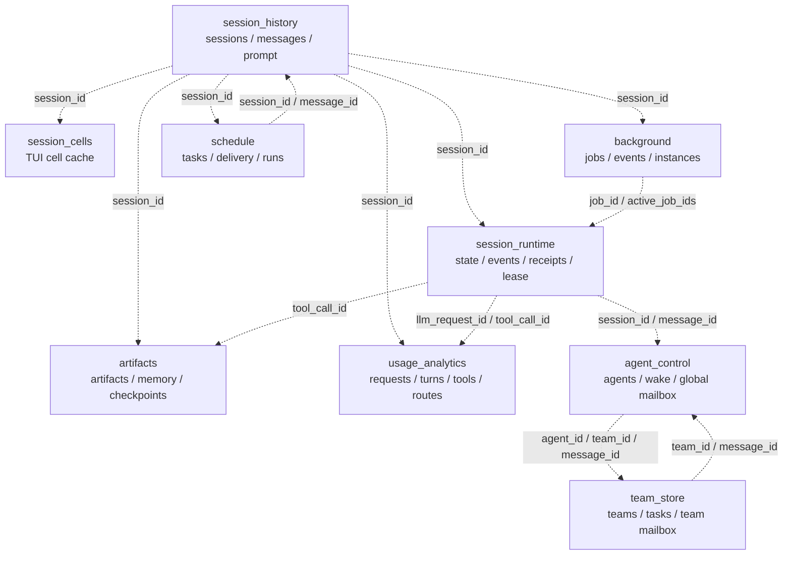

# aicli 本地数据库：功能、作用与关系

> 适用范围：`~/.aicli/sessions/` 与 `~/.aicli/data/schedule/` 下的 SQLite 存储。
>
> 本文回答三个问题：每个库**为什么存在**、每张核心表**存什么**、跨库之间**靠什么键关联**。
>
> 路径和大小以默认 CLI-local 配置为例；显式配置 `storePath`/`storeDSN` 时以配置为准。跨库关系均为**应用层逻辑关系**，不是 SQLite 外键。只有 `session_history.sqlite` 内部存在真正的 `FOREIGN KEY`。

## 1. 总览

### 1.1 九个库的分工

| 库 | 默认位置 | 领域 | 核心职责 | 事实地位 |
|---|---|---|---|---|
| `session_history.sqlite` | `~/.aicli/sessions/session_history.sqlite` | 会话内容 | 会话元数据、canonical 正文、prompt 投影 | **正文权威** |
| `session_cells.sqlite` | `~/.aicli/sessions/session_cells.sqlite` | TUI 渲染 | 长会话 cell 的写穿/冷区回填 | 可重建缓存 |
| `session_runtime.sqlite` | `~/.aicli/sessions/runtime/session_runtime.sqlite` | 会话执行 | runtime state、事件、工具回执、lease、会话邮箱、工具面 | **执行状态权威** |
| `usage_analytics.sqlite` | `~/.aicli/sessions/runtime/usage_analytics.sqlite` | 遥测分析 | 请求、turn、tool call、subagent、route、LSP、会话汇总 | **遥测事实 + 派生汇总** |
| `agent_control.sqlite` | `~/.aicli/sessions/runtime/agent_control.sqlite` | agent 协调 | agent 注册表、wake change feed、全局邮箱投影 | **agent 身份权威** |
| `background.sqlite` | `~/.aicli/sessions/runtime/background.sqlite` | 异步执行 | 后台 job、job 事件、runtime 实例心跳 | **job 状态权威** |
| `artifacts.sqlite` | `~/.aicli/sessions/runtime/artifacts.sqlite` | 大对象/恢复 | artifacts、memory entries、checkpoints、blobs | **归档与恢复权威** |
| `team_store.sqlite` | `~/.aicli/sessions/runtime/team_store.sqlite` | 团队编排 | teams、teammates、任务图、路径锁、团队邮箱 | **团队状态权威** |
| `schedule.sqlite` | `~/.aicli/data/schedule/schedule.sqlite` | 定时自动化 | 定时任务、pending 消息、投递账本、job run | **调度状态权威** |

实际路径由 CLI-local `sessionruntime.ResolvePaths` 与 `aiclipaths` 默认值解析；显式配置 `storePath`/`storeDSN` 时以配置为准。

一句话理解：

- **history**：会话“说了什么”；
- **cells**：TUI “怎么画得快”；
- **runtime**：当前执行“做到哪一步”；
- **analytics**：事后“花了多少、失败在哪”；
- **agent_control**：有哪些 agent、它们的状态如何变化；
- **background**：哪些进程在后台跑、输出是什么；
- **artifacts**：大结果、记忆和 checkpoint 存在哪里；
- **team**：多个 teammate 如何分任务、抢路径、发消息；
- **schedule**：什么时候把哪条 prompt 投给哪个会话。

### 1.2 观测快照（2026-11-06）

数量会随使用变化，下表只用于理解量级，不作为固定契约。

| 库 | 文件量级 | 代表性行数 |
|---|---:|---|
| history | ~1.8 GB | 115 sessions / 150,990 messages / 26,281 prompt rows |
| cells | ~38 MB | 15,489 cells |
| runtime | ~1.1 GB | 472,877 events / 70,327 receipts / 94,844 cache rows |
| analytics | ~1.25 GB | 125,886 requests / 155,671 tool calls / 281 sessions |
| agent_control | ~523 MB | 224 agents / 958,978 wake rows / 144 global mailbox |
| background | ~696 MB | 1,633 jobs / 365,693 events / 1,537 runtime instances |
| artifacts | ~221 MB | 2,696 artifacts / 54,502 memory / 594 checkpoints |
| team | ~266 KB | 1 team / 49 team mailbox rows，其余表基本为空 |
| schedule | ~78 KB | 1 task / 5 delivery intents / 1 delivery history |

### 1.3 四个阅读维度

后续每条表都按同一组维度描述：

1. **作用**：它解决什么问题，而不是“叫什么名字”；
2. **权威性**：是事实源、派生投影、镜像，还是临时协调状态；
3. **写入者**：哪个模块在什么时机写；
4. **读取者/关系**：谁消费它，靠什么键关联到别的库。

## 2. 各库详解

### 2.1 `session_history.sqlite`：会话正文与 prompt 投影

**作用**：保存会话的长期内容。CLI/TUI 恢复、Web 历史页、回溯、导出、checkpoint 重建都以它为正文来源。

| 表 | 作用 | 关键约束 |
|---|---|---|
| `sessions` | 会话注册表：用户、状态、标题、摘要、消息数、head offset、TTL | `id` 主键；`expires_at` 控制按龄清理 |
| `session_messages` | canonical 正文：按 `seq` 追加的不可变消息 | `(session_id, seq)` 主键；`sha256`、`identity_hash` |
| `session_prompt_messages` | 模型 prompt 投影：按 `position` 保存的 bounded 历史 | `(session_id, position)` 主键；从 messages 重新编码 |

**写路径**：

- `backend/internal/chat/sqlite_storage.go` 的 `Save/Update`；
- actor 持久化、checkpoint 重建、backtrack/compaction、导入/恢复；
- `session_messages.payload_json` 超大时改为 `artifact_path` 指向 `session-artifacts/<session>/<sha>.json`；
- `preview_json` 只是列表/大页渲染的快路径，超过 128 KiB 才保留截断版本。

**读路径**：

- `SessionStorage.Load` 优先读 `session_prompt_messages`，而不是每次反序列化完整正文；
- `GetMessagePage`/`StreamMessageJSON` 支撑历史分页、Web/TUI 回放；
- `identity_hash` 用于 checkpoint 投影重建的快速判定；
- `sha256` 用于内容校验和 artifact 去重。

**关系**：

- `sessions.id` 是跨库的根会话 ID；`session_messages.session_id`、`session_prompt_messages.session_id` 通过库内 FK 级联删除；
- 其他库的 `session_id` 都是逻辑关联，没有 SQLite 外键；
- `sessions.head_offset` 与 `session_runtime_state.head_offset` 是双写投影，当前值应保持一致；
- `session_prompt_messages` 不是 `session_messages` 的逐字节副本，而是重新编码的模型视图。

**注意**：

- `sessions.state` 与 `session_runtime_state.status` 语义不同：前者偏生命周期/列表，后者偏执行状态；不要默认二者总是一致；
- `preview_json` 与 `payload_json` 对短消息曾完全重复，现已改为等值不落库；
- 历史行不会被新写入自动回填，旧行仍保留原状。

### 2.2 `session_cells.sqlite`：TUI cell 的写穿缓存

**作用**：长会话/TUI transcript 的 cell 数量超过内存 high-water 后，把 cell 正文写穿到磁盘；逐出内存后仍可由 `Ctrl+T`/pager 冷区回填。

| 表 | 作用 | 关键约束 |
|---|---|---|
| `session_cells` | 按 cell/revision 保存渲染编码后的正文 | `(session_id, cell_id, revision)` 主键；`source_fp`/`gen` 支持增量重算 |

**写路径**：

- `backend/internal/chat/session_cell_store.go`；
- CLI 的 residency 运行时在 cell 逐出前调用 `PutCell`，写入成功才允许降级为索引；
- `INSERT OR REPLACE` 允许同一 cell/revision 覆盖。

**读路径**：

- 冷区 `GetCell` 回填；
- TUI render engine / transcript residency 适配器；
- `SessionCellCount`/`Stats` 用于观测 put/get/miss。

**关系**：

- `session_id` 逻辑关联 `history.sessions.id`；
- `cell_id` 属于渲染层身份，不与 `session_messages.seq` 建立数据库级映射；重建时按 transcript 重新生成。

**注意**：

- 它是**可重建缓存**，不是正文权威；cell 丢失可以由 history 重建；
- `storage prune-sessions` 已把 `session_cells` 纳入会话级联；cell 仍可由 history 重建；
- 短会话通常不会创建该库；只有越过 residency high-water 才会惰性打开。

### 2.3 `session_runtime.sqlite`：执行状态、事件与工具回执

**作用**：保存会话执行期的热状态和可恢复事件。它回答“当前 turn/checkpoint 是什么、工具结果是什么、resume 需要重放什么”，而不是长期正文。

| 表 | 作用 | 关键约束 |
|---|---|---|
| `session_runtime_state` | 每会话一行的执行状态：status、current turn/checkpoint、pending approval/question/tool、active jobs、head offset、run meta、稳定工具面引用 | `session_id` 主键 |
| `session_events` | 按会话 `seq` 追加的事件流：流式 delta、reasoning、tool started/finished、assistant message、turn/session 生命周期 | `(session_id, seq)` 唯一；`id` 自增 |
| `session_tool_receipts` | 工具结果的 durable 回执：完整 tool message JSON | `(session_id, tool_call_id)` 主键 |
| `cache_requests` | 缓存分析的旧持久化镜像：按 `llm_request_id` 保存请求终态 | `llm_request_id` 主键；当前本地路径已不再新写 |
| `agent_control_mailbox_records` | 会话作用域邮箱：message_id、body、ack、global_seq | 自增 id；message_id 索引 |
| `session_actor_leases` | 跨进程 actor 互斥租约：owner、pid、expires_at | `session_id` 主键 |
| `runtime_tool_surface_content` | 稳定工具面的内容寻址存储 | `fingerprint` 主键；由 state 的 `stable_tool_surface_ref` 引用 |
| `schema_migrations` | 本库 schema 版本账本 | `version` 主键 |

**写路径**：

- `backend/internal/chat/session_runtime_store.go`、`session_runtime_store_batch.go`、`session_runtime_store_cache.go`；
- `SessionActor` 保存 runtime state、追加事件、写工具回执；
- `session_actor_leases` 由 actor 生命周期/跨进程协调写入；
- 邮箱写入会话作用域邮箱表，并按需投影到 `agent_control_global_mailbox_records`；
- `runtime_retention.go` 按会话裁剪旧事件、回执、缓存和邮箱。

**读路径**：

- actor resume/restart recovery：state + events + receipts；
- 工具配对与 UI 回放：receipts + `tool_receipt_recorded` 事件；
- trajectory API：`session_events`；
- 跨进程互斥：leases；
- 邮箱消费：`agent_control_mailbox_records`；
- 稳定工具面：state 的 ref → content 表。

**关系**：

- `session_runtime_state.session_id`、`session_events.session_id`、`session_tool_receipts.session_id` 逻辑关联 `history.sessions.id`；
- `session_runtime_state.stable_tool_surface_ref` → `runtime_tool_surface_content.fingerprint`；
- `session_tool_receipts.tool_call_id` 与 `usage_analytics.usage_tool_calls.tool_call_id`、`artifacts.artifacts.tool_call_id`、`session_events` 的 `tool_call_id` 关联；
- `cache_requests.llm_request_id` → `usage_requests.llm_request_id`（旧镜像关系）；
- `agent_control_mailbox_records` 的 `message_id/session_id/team_id` 维度投影到 `agent_control_global_mailbox_records`；本地 `global_seq` 在投影后回填为 global 表的 `id`，global 表用 `(source, source_scope, source_id, source_seq)` 做幂等唯一键。

**注意**：

- `session_events` 是“可重放事件账本”，其中 `tool_finished` 仍带 live 输出；较大的 `tool_receipt_recorded` 输出已改为 `output_ref` 引用 `session_tool_receipts`，读取时回填。工具结果的权威仍是 receipts；
- `cache_requests` 是历史镜像；本地 CLI 的 cache analytics 现在优先读 `usage_requests`，`cache_requests` 仍保留用于旧数据和降级回退；
- `session_events` 的在线保留是“最近 N 条 + 单条 payload 上限”，不是按时间 TTL；
- `head_offset`/`status` 与 history 存在双写，跨库不是原子事务。

### 2.4 `usage_analytics.sqlite`：请求、turn、工具与路由遥测

**作用**：把 EventBus 上的 LLM 请求、工具调用、turn、subagent、route、LSP 和会话汇总落成可查询的遥测库。它主要服务 `/usage`、`/web/api/usage/*`、`/web/api/cache/*`、LSP baseline 和运维对账。

| 表 | 作用 | 关键约束 |
|---|---|---|
| `usage_requests` | 单次 LLM 请求终态：provider/model、tokens、cache、duration、parent/root/subagent、完整 record_json | `llm_request_id` 主键 |
| `usage_sessions` | 会话级预聚合：元数据 + `c_*` 累计计数 | `session_id` 主键 |
| `usage_turns` | 单 turn 聚合：step、tokens、工具错误、完成原因 | `(session_id, turn_id)` 主键 |
| `usage_tool_calls` | 单工具调用指标：outcome、duration、错误、输出字节、摘要 | `tool_call_id` 主键 |
| `usage_subagents` | 子代理运行：parent/child、batch、attempt、失败分类、预算 | `(subagent_id, parent_session_id, batch_id)` 主键 |
| `usage_routes` | 路由决策审计：difficulty、provider/model、fallback、候选 | `route_event_id` 主键 |
| `usage_lsp_requests` | LSP 请求/诊断/追加字节的明细 | `(session_id, path_fingerprint, server, started_unix_nano)` 主键 |
| `usage_lsp_first_publish` | 首发布时延的派生小表 | `(session_id, server)` 主键 |
| `usage_render_fence_drops` | 渲染 fence 丢弃原因/次数 | `(session_id, turn_id, dropped_class)` 主键 |
| `usage_session_turn_keys` | turn 统计幂等键，避免重复累计 | `(session_id, turn_key)` 主键 |
| `analytics_legacy_*` | 旧版分析归档：llm_requests/turns/sessions | 当前生产 0 写 0 读，仅 purge/脚本引用 |

**写路径**：

- `backend/internal/usageanalytics/ingest*.go`：订阅 EventBus，实时写 requests/tool calls/turns/subagents/routes/LSP；
- `store_stats.go`/`ingest_stats.go`：在请求终态事务里增量维护 `usage_sessions.c_*`；
- `usage_analytics compact-records`：手动压实历史 `usage_tool_calls.record_json`；
- `rebuild-stats`：从原始明细重建会话预聚合计数。

**读路径**：

- TUI `/usage`、`/web/api/usage/*`；
- `/web/api/cache/*`：通过 `usageanalytics.CacheSource` 读取 `usage_requests.record_json`；
- LSP baseline：`usage_lsp_requests` + `usage_tool_calls.record_json` 的输出字节字段；
- route/subagent 诊断；
- `sessionpurge` 按会话清理。

**关系**：

- `usage_requests.llm_request_id` 与 runtime `cache_requests.llm_request_id` 是同一请求的两套投影；本地 CLI 现在以 `usage_requests` 为单一事实源；
- `usage_requests.session_id`、`usage_turns.session_id`、`usage_tool_calls.session_id`、`usage_lsp_requests.session_id` 逻辑关联 `history.sessions.id`；
- `usage_tool_calls.tool_call_id` 关联 runtime receipts、artifacts 和 session_events；
- `usage_subagents.child_session_id` 关联子会话；`subagent_id` 与 agent_control 的 agent 身份语义相关，但不是硬 FK；
- `usage_routes.parent_session_id/child_session_id/agent_id/batch_id` 分别关联会话、agent、子代理批次；
- `usage_requests.turn_id/trace_id` 与 runtime event payload、turn 聚合共享同一逻辑键。

**注意**：

- `usage_sessions`/`usage_turns` 是派生汇总，不是原始事实；`c_*` 与原始明细可能因保留策略/历史版本而不同，必要时用 `rebuild-stats` 对账；
- `usage_tool_calls.record_json` 不是“可以整列删除”的死数据：LSP baseline 会读取 `output_model_visible_bytes`/`output_original_bytes`；新写入已按 allowlist 压实，历史大载荷应走 `compact-records`；
- `analytics_legacy_*` 已无生产读写，但 purge 表清单仍引用它们，drop 前必须先改清理代码。

### 2.5 `agent_control.sqlite`：agent 身份注册表与变更流

**作用**：跨进程/跨会话维护 agent 身份、父子关系、路由/模型、状态，以及可供 watcher/reclaim 使用的 wake change feed；同时保存 session + team 的统一邮箱投影。

| 表 | 作用 | 关键约束 |
|---|---|---|
| `agent_control_agents` | agent 当前状态：agent_id、root/parent/session、path、depth、provider/model、difficulty、status、closed_at | `agent_id` 唯一；`(root_session_id, agent_path)` 唯一 |
| `agent_control_agent_wake_events` | agent 状态变更流：upsert/stale/closed/spawn_reserved/reclaimed 等 | `id` 自增；按 agent/session/root/team/created_at 索引 |
| `agent_control_global_mailbox_records` | session + team 邮箱的统一投影：source/source_scope/source_seq + message body | `(source, source_scope, source_id, source_seq)` 唯一 |
| `schema_migrations` | schema 版本账本 | `version` 主键 |

**写路径**：

- `backend/internal/agentcontrol/global_agent_store.go`：注册/更新 agent、追加 wake 事件、保留策略；
- `backend/internal/agentcontrol/global_mailbox_store.go`：写全局邮箱投影；
- `cmd/aicli/commands/chat_actor_registry.go` / `materializeLocalAgentRegistry`：按会话/子代理身份投影 agent 行；
- team store 通过 `SetGlobalMailboxWriter` 把 team 邮箱写穿到 global mailbox。

**读路径**：

- 本地 actor registry、subagent 配额/reclaim、agent 状态面板；
- `agent_control_agents` 当前状态；
- `LastAgentControlAgentWakeSeq`/`WatchAgentControlAgentWake` 的 catch-up 水位/通知；
- `sessionpurge` 用最近 wake 行保护活跃会话；
- 全局邮箱列表/ack。

**关系**：

- `agent_control_agents.root_session_id/session_id` 关联 history/runtime 会话；
- `agent_control_agent_wake_events.agent_id/root_session_id/session_id` 关联 agents 与会话；
- `agent_control_global_mailbox_records.source_scope/source_id/session_id/team_id/message_id` 关联 runtime 的会话邮箱和 team 的团队邮箱；
- `usage_subagents.subagent_id`、`usage_routes.agent_id` 与 agent 身份语义相关。

**注意**：

- `agent_control_agents` 是当前状态权威；wake 表是 change feed，不是第二份状态；
- 当前存量 wake 表绝大多数行是 `upsert`，主要成本是重复身份字段和 6 个索引；新写入已按 agent 合并旧 `upsert`，只保留最新状态快照，生命周期跃迁仍单独保留，`MAX(id)` 水位和近期 purge 保护语义不变；
- `agent_row_id` 目前只写不读，是死列；但表的主要成本不是这一列，而是 upsert 行和索引；
- `agent_control_global_mailbox_records` 是投影，不是 source-of-truth；排查时优先看 runtime/team 的 source 表。

### 2.6 `background.sqlite`：后台进程与 job 事件

**作用**：持久化后台命令/任务的状态、生命周期事件、输出分片和 runtime 实例心跳；detached runner 的日志文件由 `log_path` 指向外部 `background_logs/`。

| 表 | 作用 | 关键约束 |
|---|---|---|
| `background_jobs` | job 当前状态：session、kind、status、command/cwd、exit_code、log_path、lease/owner、deadline | `id` 主键 |
| `background_job_events` | 追加型 job 事件/输出：queued/running/completed/output 等 | `(job_id, seq)` 唯一 |
| `runtime_instances` | runtime 实例心跳/归属：instance_id、pid、host、state | `instance_id` 主键 |

**写路径**：

- `backend/internal/background/store.go`：SaveJob、AppendEvent、实例心跳；
- `backend/internal/background/manager.go`：提交/取消/重试/租约续期；
- `backend/internal/background/detached.go`：detached runner 读日志增量并写 `output` 事件。

**读路径**：

- `task_output`/`job_output`/wait/监控；
- 后台任务列表、job 详情、日志尾部；
- 会话 supervision/资格判断；
- `sessionpurge` 保护未终态 job。

**关系**：

- `background_jobs.session_id` 关联 history/runtime 会话；
- `background_job_events.job_id` 关联 `background_jobs.id`；
- `background_jobs.owner_instance_id` 关联 `runtime_instances.instance_id`；
- runtime state 的 `active_job_ids_json` 与 job id 逻辑关联；
- `background_jobs.log_path` 指向外部日志文件，DB 中是 job 状态/事件，文件是原始输出。

**注意**：

- `background_job_events` 的 log-backed 输出分片新写入只保存 `offset/size/output_ref`，正文保留在 `log_path`；`ListEvents` 读取时从日志回填，`job_output` 直接读日志。存量历史分片仍保留在 DB，清理时要同时考虑 DB 行和日志目录；
- `runtime_instances` 当前主要被心跳写入，生产读取方法很少；它更像运维/归属元数据；
- job 状态在 `background_jobs` 与事件流中各有一份，事件流用于时间线/恢复，不是状态权威。

### 2.7 `artifacts.sqlite`：大结果、记忆与 checkpoint

**作用**：保存工具大结果、结构化 memory、compaction/checkpoint 快照，以及 checkpoint 的文件级 diff/blob。它把“正文/大对象”从 history/runtime 热路径中分离出来。

| 表 | 作用 | 关键约束 |
|---|---|---|
| `artifacts` | 工具结果归档：session、tool_name/tool_call_id、summary、content、metadata | `id` 主键；按 session/created_at 索引 |
| `memory_entries` | 结构化记忆：session/task、kind、priority、content_json、source_refs、source_hash | `(session_id, kind, source_hash)` 唯一，去重 |
| `checkpoints` | checkpoint 快照：history_hash、message_count、ledger_json、metadata | `id` 主键 |
| `checkpoint_files` | checkpoint 的文件级变更：path/op、before/after blob、hash、diff | `checkpoint_id` 关联 checkpoints |
| `blobs` | 内容寻址大对象：sha256 唯一 | `id` 主键；当前 0 行 |

**写路径**：

- `backend/internal/artifact/store.go`：SaveArtifact、SaveMemory、SaveCheckpoint；
- `checkpoint_files.go`：SaveBlob/SaveCheckpointFiles，按 sha256 去重；
- 工具执行器把大结果归档；checkpoint 由 compaction/history 逻辑写入。

**读路径**：

- `artifact` 工具/GetOwned（按 session/lineage 限权）；
- memory recall（按 kind/priority/content kind）；
- checkpoint 恢复与 history 校验；
- session 导出/诊断。

**关系**：

- `artifacts.session_id`、`memory_entries.session_id`、`checkpoints.session_id` 关联 history 会话；
- `artifacts.tool_call_id` 关联 runtime receipts / analytics tool calls；
- `checkpoints.id` ← `checkpoint_files.checkpoint_id`；`checkpoint_files.before_blob_id/after_blob_id` → `blobs.id`；
- `checkpoints.metadata_json` 可带 `conversation_blob_id` 等跨表引用；
- runtime state 的 `current_checkpoint_id` 指向 `checkpoints.id`。

**注意**：

- `artifacts` 与 `session_tool_receipts` 都可能保存工具结果：receipt 用于消息配对/回放，artifact 用于大对象归档和检索；不要把二者当成同一份数据；
- `blobs`/`checkpoint_files` 当前为空，但代码路径完整，属于“按需启用”的内容寻址层；
- memory 的 `source_hash` 是去重键，不是内容主键；`memory_entries.kind` 与 `content_json.$.kind` 是两层语义。

### 2.8 `team_store.sqlite`：团队编排与共享邮箱

**作用**：持久化 team/teammate、任务图、任务信号、路径锁、团队邮箱，以及 team 作用域的 agent-control 任务/唤醒表。它服务 team_spawn、team orchestrator、task dispatch 和 team 诊断。

| 表 | 作用 | 关键约束 |
|---|---|---|
| `teams` | 团队主记录：workspace、lead session、status、strategy、max writers | `id` 主键 |
| `teammates` | teammate 注册：team、name/profile、session、state、heartbeat | `id` 主键 |
| `team_events` | 团队事件流 | `(team_id, seq)` 唯一 |
| `team_task_signals` | 任务生命周期 wake 信号（不污染用户邮箱） | `(team_id, seq)` 唯一 |
| `team_path_claims` | 任务路径读/写锁与 lease | `id` 主键；team/task/path |
| `team_mailbox_receipts` | 团队邮箱 ack 回执 | `(team_id, message_id, agent_id)` 主键 |
| `agent_control_task_records` | 团队任务当前状态：task/team/assignee/session/agent、inputs/read/write paths、lease、fencing、route | `(workflow, task_id)` 主键 |
| `agent_control_task_dependencies` | 任务依赖边 | `(workflow, task_id, depends_on_id)` 主键 |
| `agent_control_task_graph_events` | 任务图事件 | `(workflow, team_id, team_seq)` 唯一 |
| `agent_control_wake_events` | team 作用域 wake（与 agent_control 的 agent wake 不同） | 自增 id |
| `orchestrator_owner_leases` | orchestrator owner 租约/fencing | `team_id` 主键 |
| `agent_control_mailbox_records` | team 作用域邮箱（与 runtime 同名表） | 自增 id；message_id 索引 |

**写路径**：

- `backend/internal/team/sqlite_store.go`、`agent_task_registry.go`、`mailbox.go`、`path_claims.go`、`owner_lease.go`；
- `teammate_runner.go`/`orchestrator.go` 推进任务和 teammate 状态；
- 邮件写入 team 本地表，并通过 global mailbox writer 投影到 `agent_control_global_mailbox_records`。

**读路径**：

- team orchestrator/调度、task dispatch、teammate 状态；
- 路径冲突检查、任务依赖解析、fencing；
- team 邮箱、ack、任务信号；
- runtime API 的 execution diagnostics / team 诊断；
- `sessionpurge --include-team`。

**关系**：

- `teams.lead_session_id`、`teammates.session_id`、`agent_control_task_records.session_id` 关联 history/runtime 会话；
- `teammates.id`、task `assignee`/`agent_path` 与 agent_control 的 agent 身份相关；
- `agent_control_mailbox_records.message_id/team_id` 是 global mailbox 的 team source；
- `agent_control_task_records.team_id` 关联 `teams.id`；dependency/graph 表围绕 task_id。

**注意**：

- `team_store` 与 `session_runtime` 都有一张同名的 `agent_control_mailbox_records`；前者是 team-scope，后者是 session-scope，直接合并/复制会冲突；
- `agent_control_global_mailbox_records` 已经是 session + team 的统一投影，排查“谁在读邮箱”时不要只看本地表；
- 当前库里 team 数据很少（1 个 team、49 条邮箱），但 schema 已覆盖完整任务图；不要用当前行数判断功能重要性。

### 2.9 `schedule.sqlite`：定时任务与投递账本

**作用**：保存模型/人工创建的定时任务、周期/ cron 配置、pending 兜底消息、投递意图/历史、job run。它决定“何时向哪个会话投递哪条 prompt”，不等于模型执行完成。

| 表 | 作用 | 关键约束 |
|---|---|---|
| `schedule_tasks` | 定时任务：session、kind/title/prompt、scheduled/interval/cron、status、lease、target profile | `id` 主键 |
| `schedule_pending_messages` | 投递失败后的兜底消息，等待宿主恢复消费 | 自增 id；schedule_id/session_id |
| `schedule_job_runs` | 一次调度执行的结果：status/output/error/session/时间 | 自增 id；schedule_id |
| `schedule_delivery_intents` | occurrence 级投递意图/幂等账本 | `occurrence_key` 主键 |
| `schedule_delivery_history` | 已投递消息历史：scheduled/delivered/message_id/prompt | `(schedule_id, seq)` 主键 |

**写路径**：

- `backend/internal/schedule/store.go`、`service.go`、`executor.go`、`runtime.go`；
- `cmd/aicli/commands/chat_schedule_host.go` 打开默认 `data/schedule/schedule.sqlite`；
- scheduler daemon/claim/lease 推进任务状态；
- 投递成功/失败分别写 history/pending/intent。

**读路径**：

- schedule 工具/管理 API；
- scheduler daemon 的 active task、pending 消费、misfire 处理；
- 投递回执/历史展示；
- `sessionpurge` 级联清理。

**关系**：

- `schedule_tasks.session_id`、`schedule_pending_messages.session_id`、`schedule_job_runs.session_id` 关联 history/runtime 会话；
- `schedule_pending_messages.schedule_id`、`schedule_job_runs.schedule_id`、`schedule_delivery_intents.schedule_id`、`schedule_delivery_history.schedule_id` 关联 `schedule_tasks.id`；
- `schedule_delivery_history.message_id` 是投递消息 id，和邮箱/会话消息 id 的语义由投递实现决定，不能默认等于 history 的 message_id；
- schedule 可以指向 session/workspace/headless，target_kind 决定后续执行位置。

## 3. 跨库关系

### 3.1 关系图

下图所有边都是应用层关联（虚线），不是 SQLite 外键；同一逻辑域内只是调用频率更高。

### 3.2 关键身份键

| 键 | 定义 | 出现的核心位置 | 用途 |
|---|---|---|---|
| `session_id` | 会话根 ID | history.sessions、runtime、analytics、artifacts、background、team、schedule | 几乎所有跨库关联的根键 |
| `message_id` | 单条消息/邮箱消息 ID | history `payload_json.metadata`、runtime/global mailbox、schedule delivery history | 回放、消息追溯、邮箱 ack |
| `seq` | 会话/流内序号 | `session_messages`、`session_events`、`team_events`、`background_job_events` | 会话内有序回放 |
| `position` | prompt 投影位置 | `session_prompt_messages` | 模型上下文顺序 |
| `trace_id` / `turn_id` | LLM 调用链/turn 身份 | runtime events、analytics requests/turns/tool calls/routes | 请求级关联、turn 聚合 |
| `llm_request_id` | 单次 LLM 请求 ID | runtime.cache_requests、analytics.usage_requests | 请求去重、缓存分析 |
| `tool_call_id` | 单次工具调用 ID | runtime receipts、analytics.usage_tool_calls、artifacts、session_events | 工具结果配对 |
| `agent_id` | agent 身份 | agent_control.agents/wake、analytics.subagents/routes、team task assignee | 配额、状态、路由、回收 |
| `job_id` | 后台 job ID | background.jobs/events、runtime `active_job_ids_json` | 后台任务恢复/监督 |
| `artifact_id` | 归档大对象 ID | artifacts、tool receipt metadata、usage_tool_calls JSON | 大结果读取 |
| `checkpoint_id` | 快照 ID | runtime `current_checkpoint_id`、artifacts.checkpoints/files | 恢复/回溯 |
| `team_id` / `task_id` | 团队/任务身份 | team_store、agent_control agents/wake、analytics subagents/routes 的 batch/agent | 团队调度、路径锁、任务图 |
| `schedule_id` | 定时任务 ID | schedule.tasks/pending/runs/delivery | 调度幂等与账本 |

### 3.3 关系矩阵

| 源 → 目标 | 关联键 | 关系性质 |
|---|---|---|
| history → cells | `session_id` | 正文 → 可重建渲染缓存 |
| history → runtime | `session_id` | 正文/元数据 → 执行状态与事件 |
| history → analytics | `session_id` | 会话 → 遥测聚合 |
| history → artifacts | `session_id` | 会话 → 归档、memory、checkpoint |
| history → background | `session_id` | 会话 → 后台 job |
| history → schedule | `session_id` | 会话 → 定时投递 |
| runtime → analytics | `llm_request_id` | 同一请求的旧镜像 → 汇总事实源 |
| runtime → analytics | `tool_call_id` | 工具回执 → 工具指标 |
| runtime → artifacts | `tool_call_id` | 工具结果 → 大对象归档 |
| runtime → agent_control | `session_id` / mailbox `message_id` | 会话执行 ↔ agent 身份/邮箱投影 |
| agent_control → team | `agent_id` / `team_id` / `message_id` | agent 身份 ↔ 团队任务/邮箱 |
| team → agent_control | `team_id` / `message_id` | 团队邮箱 → 全局邮箱投影 |
| background → runtime | `job_id` / `active_job_ids_json` | job 状态 ↔ 会话 active jobs |
| analytics → team | `batch_id` / `subagent_id` / `agent_id` | 子代理/任务遥测 ↔ 团队任务身份（语义关联，非硬 FK） |
| schedule → history | `session_id` | 调度任务 → 目标会话 |

### 3.4 为什么没有跨库外键

- 九个库是独立 SQLite 文件，SQLite 原生不支持跨文件外键；
- 每个库有独立连接池/写锁/迁移版本；跨库事务会放大锁竞争，当前选择“单库事务 + 应用层级联”；
- 只有 `session_history` 内部的 `session_messages`/`session_prompt_messages → sessions` 是真正 FK；
- 跨库删除由 `internal/sessionpurge` 逐库执行，**不是跨库原子事务**：某库失败时已完成的库可能已删除，命令通过幂等重跑收敛；
- 因此任何跨库写入都必须保证键的稳定性；不能依赖数据库帮你校验 orphan。

## 4. 权威数据与投影

| 数据 | 权威 | 派生/镜像/缓存 | 说明 |
|---|---|---|---|
| 会话元数据 | `history.sessions` | `usage_sessions` 部分字段 | runtime state 也有 status/head_offset，属于执行投影 |
| canonical 正文 | `history.session_messages` | `session_prompt_messages`、`session_cells` | prompt 是模型视图，cell 是 TUI 缓存 |
| prompt 投影 | `history.session_prompt_messages` | 可由 messages 重建 | 不是逐字节副本，重新编码 |
| 会话执行状态 | `runtime.session_runtime_state` | `history.sessions.state`/`head_offset` 部分投影 | 两侧语义不完全相同 |
| 事件/续传 | `runtime.session_events` | analytics 部分指标 | 事件账本用于 resume/trajectory |
| 工具结果 | `runtime.session_tool_receipts` | `usage_tool_calls`、`session_events`、`artifacts` | receipt 是消息配对权威；analytics 是指标；artifact 是大对象 |
| LLM 请求 | `usage_requests` | `cache_requests`（旧镜像） | 本地 cache 已优先读 usage；旧数据仍可能只在 cache_requests |
| agent 身份/状态 | `agent_control_agents` | `agent_control_agent_wake_events` | wake 是 change feed，不是第二份状态 |
| 全局邮箱 | `agent_control_global_mailbox_records` | runtime/team 本地邮箱 | global 是投影；source 表用于本地消费 |
| 后台 job | `background_jobs` | `background_job_events`、`log_path` | job 状态权威；events/log 是时间线与输出 |
| 归档/记忆/快照 | `artifacts` 库 | `blobs`/`checkpoint_files` 按需启用 | checkpoint 与 history 校验关联 |
| 团队任务 | `team_store.agent_control_task_records` | team_events/signals/mailbox | 任务状态权威；事件/信号是时间线 |
| 定时任务 | `schedule_tasks` | pending/delivery/job_runs | delivery 是投递账本，不代表模型完成 |

**结论**：判断“某数据能不能删”时，先看它在表中是**权威、派生、镜像、缓存还是协调状态**，不要只看有没有 `SELECT`。

## 5. 写入与读取链路

### 5.1 写入链路

1. **会话正文**：actor/SessionManager → `history.session_messages`（canonical）+ `history.session_prompt_messages`（投影）+ `history.sessions`（元数据/TTL）。
2. **执行状态**：actor → `runtime.session_runtime_state`、`session_events`、`session_tool_receipts`、leases；必要时写 artifact/checkpoint。
3. **事件总线**：同一 EventBus 被 usage analytics 与 cache analytics 订阅；usage collector 写 `usage_requests`/`usage_tool_calls`/`usage_turns`/`usage_sessions`，cache 分析优先读 `usage_requests`，不再新写 legacy mirror。
4. **agent/团队**：actor registry → `agent_control_agents` + wake；team orchestrator → `team_store`；邮箱写本地 source 表并投影到 global mailbox。
5. **后台**：background manager → `background_jobs` + `background_job_events` + runtime instance heartbeat + 外部日志。
6. **定时**：schedule service → tasks/runs/pending/delivery；到期投递到目标会话。
7. **大对象/恢复**：工具执行器 → `artifacts`；checkpoint 逻辑 → `checkpoints`/`blobs`/`checkpoint_files`。

### 5.2 读取链路

| 场景 | 主读库/表 | 关联读 |
|---|---|---|
| CLI/TUI 恢复会话 | history prompt projection + runtime state/events/receipts | artifacts checkpoint、cells 冷区 |
| Web 历史页 | history messages/prompt + cells | runtime trajectory（按需） |
| 断线/重连续传 | runtime `session_events` | runtime state、receipts |
| 工具结果查看 | runtime receipts / artifacts | analytics tool calls、session_events |
| `/usage`、`/web/api/usage` | analytics usage_* | history 会话元数据 |
| `/web/api/cache` | `usage_requests`（优先）/ `cache_requests`（旧镜像） | history 消息上下文 |
| LSP baseline | analytics `usage_lsp_requests` + `usage_tool_calls.record_json` | — |
| agent 面板/配额 | agent_control agents/wake | team task/agent、runtime session |
| 后台任务 | background jobs/events + logs | runtime active_job_ids、session |
| 团队调度 | team task records/dependencies/signals/mailbox | agent_control global mailbox、history |
| 定时任务 | schedule tasks/delivery/runs | history session、runtime state |
| 按龄清理 | 全部库的 session 键 | `sessionpurge` 候选/保护 |

## 6. 生命周期、保留与清理

### 6.1 会话生命周期

- `history.sessions.expires_at` 是整场会话的 TTL 门槛；关闭/归档时会写入宽限期（当前维护文档描述为 30 天）；
- `expires_at` 在未来时，即使 `updated_at` 很旧也不会被 `prune-sessions` 删除；
- runtime state/lease/background/schedule/agent 的“活跃保护”会阻止整场删除，避免删掉仍在执行的会话；
- 跨库删除不是原子事务；失败后按幂等重跑收敛。

### 6.2 各库保留策略

| 库/表 | 默认策略 |
|---|---|
| history | 跟随 session TTL；`prune-sessions` 级联删除 messages/prompt/sessions |
| cells | 随 `prune-sessions` 按会话删除；cell 可由 history 重建 |
| runtime events | 单会话最近 2,048 条；单条 payload 上限 256 KiB；`prune-runtime` 默认按 48h 清理 assistant 流式事件 |
| runtime receipts | 单会话最近 2,048 条 / 最多 8 MiB |
| runtime cache_requests | 单会话最近 4,096 条（legacy）；本地新路径不再写 |
| runtime mailbox | 单会话最近 2,048 条 |
| analytics raw detail | 代码默认 90 天（可配置），`usage_sessions`/`usage_turns` 等汇总可继续保留 |
| agent wake | 年龄保留 + 每 agent 活跃上限；终态行按 retention 清理 |
| background | 跟随会话清理/job 生命周期；输出日志在外部目录 |
| artifacts | 跟随会话清理；无引用 blob 可回收；memory/checkpoint 随会话 |
| team | `--include-team` 时参与 `prune-sessions`；任务/事件/邮箱按会话或团队清理 |
| schedule | 任务/投递历史/pending/runs 由 schedule 生命周期和 purge 处理 |

### 6.3 维护命令与边界

- `storage prune-runtime`：只处理 runtime 库内的事件/回执/缓存/邮箱/旧内联工具面；
- `storage prune-sessions`：按会话跨库级联；`--fast` 跳过 orphan 全表扫描，不代表没有 orphan；
- `storage compact`：独占 `VACUUM`，**删除数据本身不会自动缩小文件**；
- `usage-analytics compact-records`：压实历史 `usage_tool_calls.record_json`，不删除行；
- `usage-analytics rebuild-stats`：从明细重建会话预聚合，修复 `c_*` 漂移；
- 详见 `docs/aicli/storage-maintenance.md`。

## 7. 设计结论与使用建议

### 7.1 这不是“九个随便拆开的库”，而是按写入频率和生命周期分层

- **history** 是低频、大体积、强一致的正文事实，适合独立备份/VACUUM；
- **runtime** 是高频、可裁剪的执行热数据，和 actor 生命周期绑定；
- **analytics** 是高频追加遥测，和正文/执行解耦，适合独立保留/重算；
- **artifacts** 是大对象/恢复数据，独立库便于按对象回收和备份；
- **agent_control/team/background/schedule** 是协调状态，写入频率/清理策略各不相同。

因此不建议为了“减少库数量”做无条件物理合并；优先消除**同一事实的重复投影**。若一定要合并：
- `cells → runtime` 风险最低；
- `team/schedule` 当前数据量小，但表名冲突和清理语义要先解决；
- `analytics + background + agent_control` 合并会放大 SQLite 单写者锁竞争，应先压测；
- `artifacts` 建议保持独立，便于对象级维护和备份。

### 7.2 恢复优先级

需要完整恢复一个会话时，优先顺序是：

1. `history`：正文 + prompt 投影；
2. `runtime`：state/events/receipts/leases；
3. `artifacts`：checkpoint、大结果、memory；
4. `agent_control`/`team`/`schedule`：如果涉及多 agent/团队/定时任务；
5. `analytics`：默认不是恢复必需，主要用于事后分析；
6. `cells`：可重建缓存，最后考虑。

### 7.3 已知边界/重复点（阅读时需注意）

- `sessions.state` 与 `session_runtime_state.status` 双写且语义不同；
- `cache_requests` 是旧请求镜像，本地 cache 已优先读 `usage_requests`；
- `session_prompt_messages` 是派生投影，不是 `session_messages` 的字节副本；
- `session_events` 中 `tool_finished` 仍带工具输出；较大的 `tool_receipt_recorded` 已改为引用 receipts；
- `background_job_events` 的 log-backed 输出已改为元数据引用；存量行和 log 缺失场景仍可能有内联正文；
- `agent_control_agent_wake_events` 多数行是 upsert，不是业务状态表；
- `agent_control_global_mailbox_records` 是 runtime/team 邮箱的投影；
- `usage_sessions`/`usage_turns` 是汇总，和原始明细可能因保留策略/历史版本产生差异；
- `session_cells` 可重建，现已随整场会话级联删除。

### 7.4 新增存储时的约定

新增表/库前至少回答：

1. 它属于哪个域：正文、执行、遥测、归档、协调？
2. 它是权威事实还是派生/镜像/缓存？
3. 主键/关联键是什么，跨库靠哪个 ID 关联？
4. 写入频率、单写者冲突、保留/清理策略是什么？
5. 删除会话时是否要级联，是否需要活跃保护？
6. 能否从现有事实重建；如果不能，备份/恢复顺序是什么？

## 8. 附录：当前表清单

| 库 | 业务表 |
|---|---|
| history | `sessions`、`session_messages`、`session_prompt_messages` |
| cells | `session_cells` |
| runtime | `session_runtime_state`、`session_events`、`session_tool_receipts`、`cache_requests`、`agent_control_mailbox_records`、`session_actor_leases`、`runtime_tool_surface_content` |
| analytics | `usage_requests`、`usage_sessions`、`usage_turns`、`usage_tool_calls`、`usage_subagents`、`usage_routes`、`usage_lsp_requests`、`usage_lsp_first_publish`、`usage_render_fence_drops`、`usage_session_turn_keys`、`analytics_legacy_llm_requests`、`analytics_legacy_turns`、`analytics_legacy_sessions` |
| agent_control | `agent_control_agents`、`agent_control_agent_wake_events`、`agent_control_global_mailbox_records` |
| background | `background_jobs`、`background_job_events`、`runtime_instances` |
| artifacts | `artifacts`、`memory_entries`、`checkpoints`、`checkpoint_files`、`blobs` |
| team | `teams`、`teammates`、`team_events`、`team_task_signals`、`team_path_claims`、`team_mailbox_receipts`、`agent_control_task_records`、`agent_control_task_dependencies`、`agent_control_task_graph_events`、`agent_control_wake_events`、`orchestrator_owner_leases`、`agent_control_mailbox_records` |
| schedule | `schedule_tasks`、`schedule_pending_messages`、`schedule_job_runs`、`schedule_delivery_intents`、`schedule_delivery_history` |

各库的 `schema_migrations` 是迁移账本，不参与业务关联，未在上表重复列出。

---

**相关文档**：

- `docs/aicli/storage-maintenance.md`：按龄清理、prune-runtime、prune-sessions 与 compact 的实际命令和边界；
- `docs/analysis/storage-write-path-and-duplication-analysis-20261106.md`：写入路径与数据重复的实测；
- `docs/analysis/storage-reference-and-write-point-audit-20261106.md`：表/字段级引用与死数据审计。
