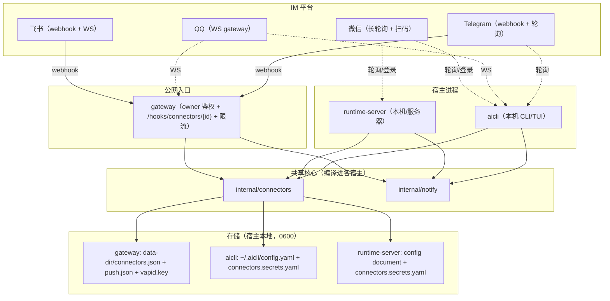
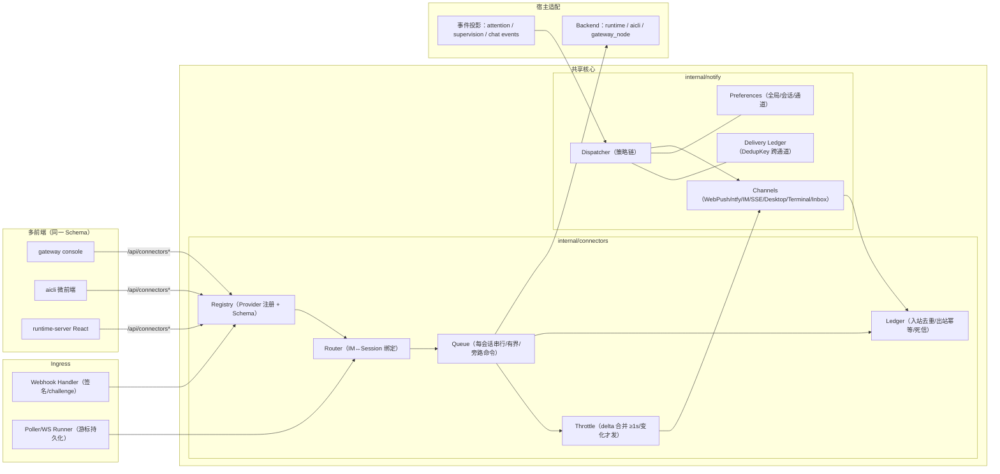
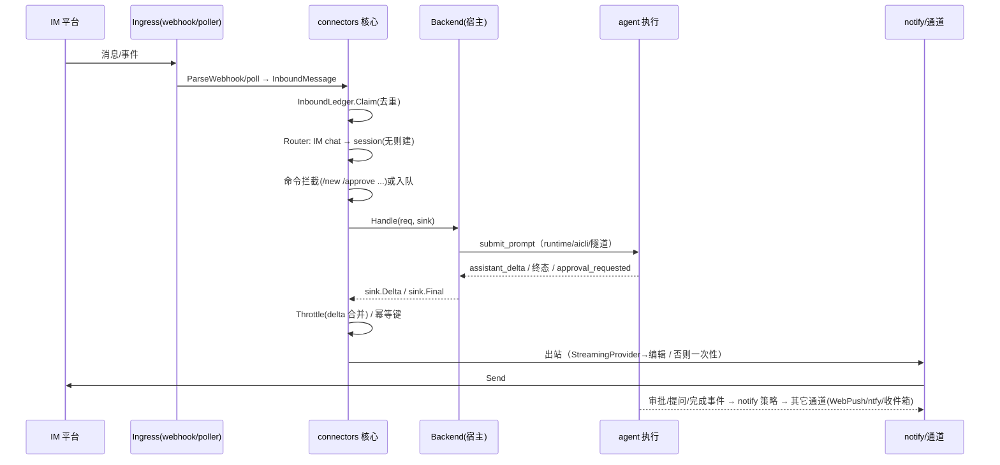
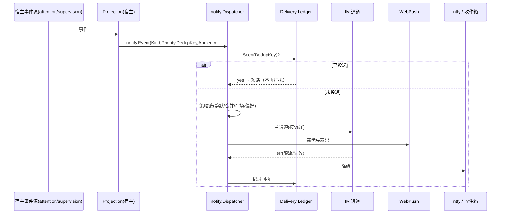
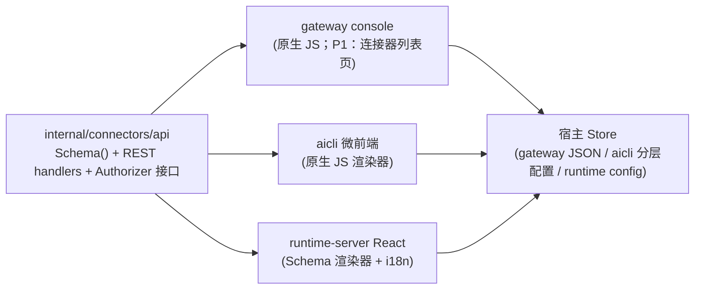
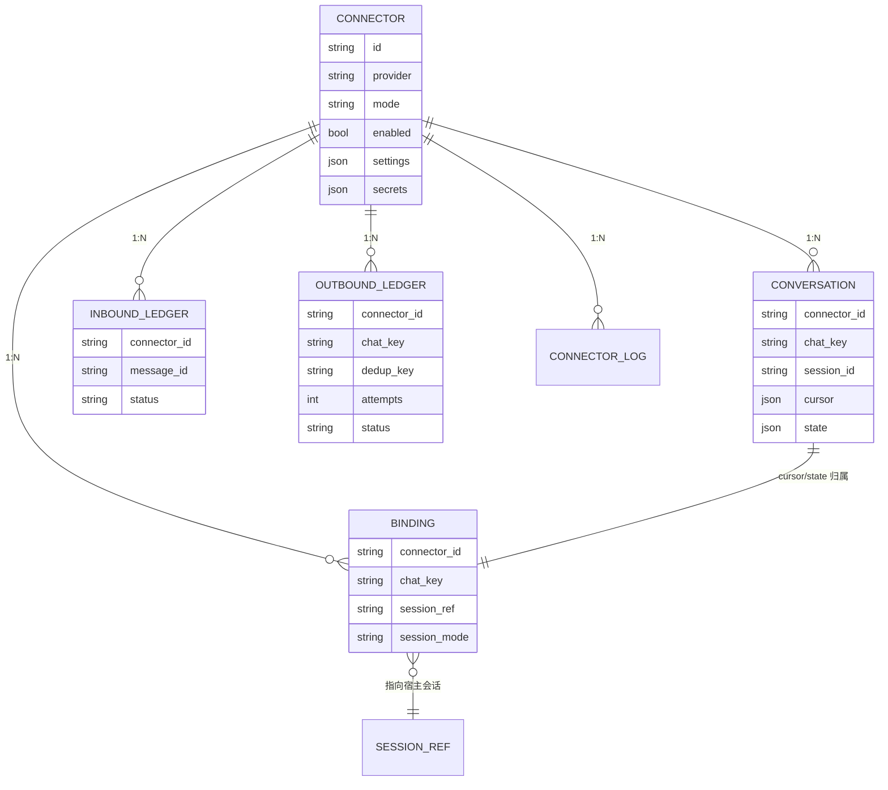

# 06 · 目标架构（定稿）与核实

> 上游：[05-review-and-hardening.md](./05-review-and-hardening.md) ｜ 本文三件事：
> ① 把 05 的决策清单按**最佳实践**定稿；② 给出**目标架构图**（部署/组件/数据流/配置面）；
> ③ 对每条架构断言做**代码级核实**（含证据与待建清单）。

---

## 1. 决策定稿（D1–D8 + 补充 D9/D10）

| 编号 | 决策 | **定稿** | 最佳实践依据 | 影响 |
|------|------|----------|--------------|------|
| D1 | 去重/在场的权威源 | **`internal/notify` 中台是唯一权威**；宿主只上报"在场信号"（gateway presence、runtime SSE 订阅/页面可见性、aicli 前台窗口） | 单一事实源（SSOT）：策略只能有一处实现，否则必然漂移 | 三宿主的 presence 收敛为 `PresenceSignal`；gateway 现有 presence 注册表保留，仅上送 |
| D2 | IM 会话 ↔ runtime 会话 | **默认 1:1**（首次来信自动建会话；`/new` 显式新开）；thread/topic→会话映射作为 **opt-in 策略** | 最小惊讶原则 + 渐进增强；避免首期引入不可预测的映射规则 | Binding 增加 `session_mode: chat|thread` |
| D3 | 运行拓扑 | **三宿主均可运行连接器**；**webhook 通道只允许公网宿主（gateway）**暴露；polling/WS 任意宿主但**单所有者** | 入口与执行分离（公网 ingress ≠ 本地执行）；NAT/合规约束 | gateway 提供统一 `/hooks/connectors/{id}`；本地宿主只跑轮询类通道 |
| D4 | 是否引入 `internal/notify` 中台 | **引入**；采用绞杀者模式：先抽策略内核并保持 gateway 行为（现有单测当护栏），再迁到三宿主 | Strangler Fig + behavior-preserving refactor：大重构必须可灰度、可回滚 | 新增 `backend/internal/notify/`；`cmd/gateway/notify_policy.go` 逻辑迁入并留适配层 |
| D5 | 事件总线异步订阅 | **做（P-1）**；新增 `SubscribeAsync`（有界队列 + panic 隔离 + 丢弃策略 + 指标），**不改变**现有 `Subscribe` 语义 | Additive API + Bulkhead：隔离慢消费者，保护主循环；向后兼容 | `backend/internal/events/bus.go` 增量改造；连接器与新消费者一律用 `SubscribeAsync` |
| D6 | 通知偏好粒度与默认 | **三级**（全局/会话/通道）+ 优先级门槛；默认：`high`=多通道去重扇出；`normal`=**单一主通道**（已绑定 IM 则 IM，否则 Web Push）；`low`=仅收件箱 | 默认抑制噪声（default-deny noise），更多通道需显式开启 | `notify.PreferenceStore` 三级键：`global / session:<id> / channel:<name>` |
| D7 | 微信/QQ 账号来源 | **官方开放平台优先**；第三方方案作为实验通道（Provider 可插拔），默认不启用 | 合规与稳定性优先；隔离不确定性 | Provider 层已解耦，第三方实现不污染核心 |
| D8 | 密钥管理 | **本地文件（0600）**，与现有 `vapid.key/push.json/devices.json` 同级；主备共享同一数据目录；预留 `SecretProvider` 接口以便将来接外部 KMS | 与既有安全模型一致（04-security.md 分层）；避免引入新依赖 | 三宿主：gateway `--data-dir`、aicli `~/.aicli`、runtime-server 配置目录 |
| D9（补充） | 事件与通知语义登记 | **契约优先**：新增 runtime 事件必须在 `internal/events/contract.go` 登记；新增通知 kind 必须在共享语义表登记（kind↔优先级↔文案↔免打扰） | 契约测试/门禁可防语义漂移 | 语义表放 `internal/notify/kinds.go` + 文档对照 |
| D10（补充） | 可观测命名 | 指标固定前缀 `connectors_*` / `notify_*`；日志字段固定（`connector_id/provider/direction/dedup_key/trace_id`） | 统一遥测便于跨宿主聚合告警 | 三宿主共用指标注册器接口 |

> 05 §6 的三条 P0 加固（总线异步订阅、notify 内核抽取、契约包+矩阵）**确认为必做**，并入 P-1。

---

## 2. 目标架构图

### 2.0 一页速览（ASCII）

```
                    ┌──────────────────────── 公网 ────────────────────────┐
飞书/微信/QQ/Telegram ──webhook──▶ gateway:/hooks/connectors/{id}（签名校验）│
                    └───────────────────────┬────────────────────────────┘
                                            │
      ┌─────────────────────────────────────┼─────────────────────────────────────────┐
      │  宿主进程（gateway / aicli / runtime-server）                                  │
      │                                                                               │
      │   connectors（双向连接器中台）              notify（通知治理中台）               │
      │   ┌───────────────────────────┐            ┌───────────────────────────────┐   │
      │   │ Provider 收发/媒体/重连    │            │ 策略: 去重/优先级/静默/合并/在场 │   │
      │   │ Router  IM↔session 绑定    │            │ 通道: WebPush|ntfy|IM|SSE|桌面 │   │
      │   │ Queue   每会话串行/有界    │            │ 账本: 幂等键 + 回执 + 熔断      │   │
      │   │ Ledger  入站去重/出站幂等  │            └──────────────┬─────────────────┘   │
      │   └───────────┬───────────────┘                           │                    │
      │               │ Backend 适配                              │ 投影               │
      │   ┌───────────▼───────────┐   ┌───────────────────────────▼─────────────────┐  │
      │   │ runtime: submit_prompt│   │ 事件源：attention / supervision / chat events │  │
      │   │ aicli:  SubmitPrompt  │   │ （经 SubscribeAsync 隔离消费）                 │  │
      │   │ gateway: 隧道→node会话 │   └──────────────────────────────────────────────┘  │
      │   └───────────────────────┘                                                     │
      │   存储：Connector/Binding/Conversation/Ledger（宿主各自实现 Store 接口）           │
      └─────────────────────────────────────────────────────────────────────────────────┘
             ▲                              ▲                                ▲
      gateway console                aicli 微前端                  runtime-server React
      （同一份 Schema 渲染）
```

### 2.1 部署拓扑



> 规则：**webhook 通道必须经公网宿主**（D3）；轮询/WS 通道可就地跑在本地宿主（NAT 友好）。
> 同一连接器在多个宿主同时启用时，轮询类靠 ownership 抢占，webhook 类靠路由只落一处。

### 2.2 逻辑组件（核心分层）



> **gateway 宿主落地（2026-10-12）**：`Backend=gateway_node` 不在网关内执行 agent，
> 而是经反向隧道把消息转发到目标节点的同步远程调用端点 `POST /web/api/invoke`
> （`tunnel.Server.ServeProxy` → 节点侧 `internal/gateway/agent/forward.go` 注入本机
> 写令牌），把最终 assistant 文本映射回 `BackendResult`；目标节点取
> `settings["node_id"]`，未指定时要求「恰好一个非 stale 节点」，否则明确报错（不猜）。
> gateway 存储用 `internal/connectors/storejson`（`<data-dir>/connectors.json` 配置+
> 密钥、`connectors-state.json` 绑定/账本/游标/归属，均 0600，跨进程写锁复用
> `storefile.AcquireDirLock`），与 aicli/runtime-server 的 `config.yaml` + `state.json`
> 不共享文件、只共享 Schema 与语义。

### 2.3 入站消息流（IM → agent → 回复）



### 2.4 通知分发流（跨通道去重与降级）



### 2.5 配置与多前端平面



> 护栏：三个渲染器共用同一 JSON Schema 快照；契约测试矩阵对三宿主跑同一组 golden 用例（CI 门禁）。
>
> **gateway console 页范围（P1 切片，2026-10-12）**：`#connectors` 已落地为**最小列表页**
> ——`GET /api/connectors` 渲染 id/provider/启停/`active_owner`/`secret_keys`，提供
> 管理接口 JSON 与 Schema 跳转；Schema 表单编辑、测试消息、日志查看与 aicli 微前端/
> React 前端同批（P1 后续），三端渲染器代码各自维护、契约同源，不与前端 repo 耦合。

### 2.6 数据与账本关系



---

## 3. 组件清单：现有 / 改造 / 新增

| 组件 | 现状 | 处置 | 落点 |
|------|------|------|------|
| `internal/events.Bus` | 同步发布、无隔离（`bus.go:314-344`） | **改造（增量）**：新增 `SubscribeAsync`（队列/回收/丢弃策略/指标），不动现有 API | `backend/internal/events/bus.go` |
| 通知策略（优先级/静默/合并/presence） | gateway 独有（`cmd/gateway/notify_policy.go`、`push.go:88-145`） | **抽取** | 新 `backend/internal/notify/{policy,dispatcher,kinds}.go` |
| Web Push / ntfy 通道 | 已实现（`internal/gateway/push`、`internal/gateway/ntfy`） | **包装为 Channel** | `notify/channels/{webpush,ntfy}.go`（适配器，行为不变） |
| supervision 收件箱 | runtime-server 已有（`supervision.Notification`） | **作为 Channel/兜底**并用同一 DedupKey | `internal/api/runtimeapi` 适配器 |
| 浏览器桌面通知 | React 前端自实现（`agent-chat-turn/notifications.ts:14-27`） | **收敛到 notify**（前端只消费 `audience=web` 的投递） | `frontend/src/hooks/workspace/...` |
| 终端标题/声音 | aicli（`chat_notification*.go`） | **作为 Terminal Channel**（可选） | `cmd/aicli/commands` 适配器 |
| 连接器核心 | 无 | **新增** | `backend/internal/connectors/` |
| Provider×4 | codex-server 可移植 | **移植/改写**（见 04 文档映射表） | `backend/internal/connectors/providers/*` |
| 管理 API 契约包 | 无 | **新增** | `backend/internal/connectors/api/` |
| webhook 入口 | 无（现有 `/api/*` 全 owner） | **新增命名空间** | `cmd/gateway`：`/hooks/connectors/{id}` |
| 三前端配置页 | 各自为政 | **新增渲染器** | `cmd/gateway/console`、`cmd/aicli/commands/web/js`、`frontend/src/pages` |

---

## 4. 核实（verification）

### 4.1 已核实（架构断言 ↔ 代码证据）

| # | 断言 | 证据（已亲自复核） | 结论 |
|---|------|--------------------|------|
| V1 | runtime-server 使用有界留存事件总线 | `backend/internal/api/runtimeapi/handler.go:527,4687`；`backend/internal/events/bus.go:247` | ✅ |
| V2 | 总线发布为同步、无隔离（G1 成立） | `backend/internal/events/bus.go:314-344`（发布者 goroutine 直接遍历 handler） | ✅ 缺口确认 |
| V3 | runtime-server 提供 agent 注入入口 | `POST /api/agent/chat`：`handler.go:946-953`；命令端点：`session_runtime_handlers.go:935/1015/1040`（`submit_prompt`/`approve_tool`/`answer_question`） | ✅ |
| V4 | aicli 提供进程内提交入口 | `backend/cmd/aicli/commands/chat_actor_registry.go:60`（`SubmitPrompt`→`SessionHub.GetOrCreate`） | ✅ |
| V5 | gateway 具备 owner 鉴权 + 独立路由 + 内嵌控制台 | `cmd/gateway/main.go:405-711`（路由/鉴权）、`cmd/gateway/console.go:11-64`（embed+SPA 兜底）、`cmd/gateway/main.go:204-236`（flags） | ✅ |
| V6 | gateway 通知策略内核存在且可抽取 | `cmd/gateway/push.go:88-145`（attention 差分）、`cmd/gateway/notify_policy.go:16-122`（优先级/静默/合并） | ✅ |
| V7 | ntfy 通道已实现并线上可用 | `internal/gateway/ntfy/ntfy.go`；runbook §14 记录 `ntfy.ttai.online` 与 `--ntfy-url` | ✅ |
| V8 | React 端已有本地桌面通知（与 Web Push 可能重复） | `frontend/src/hooks/workspace/agent-chat-turn/notifications.ts:14-27`（`visibilityState !== "visible"` 才弹） | ✅ 重复风险确认 |
| V9 | runtime-server 有持久化监督收件箱 | `backend/internal/api/runtimeapi/background_supervision.go`、`agent_child_completion_recovery.go`（`ListNotifications`） | ✅ |
| V10 | 三个前端各有配置面（成熟度不同） | React：`frontend/src/pages/runtime-config-page.tsx:16`；微前端：`cmd/aicli/commands/web/js/menu.js:141-156`、`provider-editor.js`；console：`cmd/gateway/console/app.js`（无设置页） | ✅ |

### 4.2 待建（需实现，含落地验收）

| # | 待建项 | 验收证据（可执行） |
|---|--------|--------------------|
| N1 | `events.SubscribeAsync`（队列+recover+丢弃策略+指标） | 单测：慢订阅不阻塞发布（延迟注入）；panic 不传播；队列满按策略丢弃并计数 |
| N2 | `internal/notify` 策略内核 + gateway 适配（行为不变） | 现有 `cmd/gateway` 全部单测通过；新增跨通道去重用例（同 DedupKey 只投一次） |
| N3 | IM 作为 notify Channel | 契约测试：绑定后 `normal` 只走主通道；`high` 扇出且去重。连接器侧出站助手已就绪（`Service.NotifySession`/`NotifyAttention`，2026-10-13，见 03 §6），剩余为 `notify.Dispatcher` 的 IM Channel 适配与跨通道去重账本 |
| N4 | `internal/connectors` 核心 + Telegram Provider | 端到端：Telegram→runtime-server→回复；断线续传不重复 |
| N5 | `/hooks/connectors/{id}`（签名/挑战校验） | 未签名请求 401/403；重放/错误 secret 用例 |
| N6 | `connectors/api` 契约包 + 三宿主矩阵 | CI：同一 golden 用例 × 3 宿主全绿 |
| N7 | 三前端 Schema 渲染器 | Schema JSON 快照测试一致；未知字段降级不报错 |
| N8 | 可观测性（`connectors_*`/`notify_*`） | 指标暴露 + 两端 UI 展示（队列深度/失败率/最近错误） |

**实现状态（2026-10-13，P-1 首轮）**：

| 项 | 状态 | 证据 |
|----|------|------|
| N1 `events.SubscribeAsync` | ✅ 已完成 | `backend/internal/events/async.go`（队列/丢弃策略/panic 隔离/计数）+ `async_test.go`（9 例）；`bus.go` 仅做字段改名与 `subscribeDispatch` 抽取，既有测试全绿 |
| N2 `internal/notify` 策略内核 | ◐ 部分完成 | `backend/internal/notify/policy.go`（`PriorityOf`/`IsHighPriority`/`QuietRange`/`ParseQuietHours`/`InQuietHours`/`Coalesce`）；`cmd/gateway/notify_policy.go` 退化为薄适配层，行为由既有单测护栏；**2026-10-14 内核切片一**：`internal/notify/{kinds,ledger,dispatcher}.go` 落地（语义登记表 + 跨通道 DedupKey 原子认领账本 + 优先级路由分发器；测试 9 例）；**待续**：通道适配（WebPush/ntfy/IM 包装为 Channel）、宿主切流（gateway 行为不变护栏）、偏好/在场（P1） |
| N6 `connectors/api` 契约骨架 | ✅ 已完成 | `backend/internal/connectors/api/schema.go`（ProviderSchema/FieldSchema/ActionSpec + `Validate`/`SortedSecretKeys`/`MergeSubmit`/`ClearSecret`）与 JSON 契约快照测试；HTTP 层 `internal/connectors/restapi` 已落地（管理面 `/connectors*` + webhook `/hooks/connectors/{id}`，`Authorize` 由宿主注入，集成测试 12 例）；**契约矩阵（2026-10-12）**：三宿主同一 golden 落地——`internal/connectors/restapi/testdata/connectors_schema.golden.json`（text/secret/url/bool/enum/number + actions + modes 的 Schema 逐字节快照，`-update` 更新入口）+ `contract_golden_test.go` 的列表视图 key 集合（11 键）/错误载荷形状断言 + `cmd/runtime-server/connector_mount_test.go` 对宿主真实 `mountConnectorRoutes` 的挂载断言（aicli/gateway 已有同形状挂载测试） |
| N4 `internal/connectors` 核心 + Telegram Provider | ◐ 核心/polling/三宿主接线/React 页完成 | `backend/internal/connectors/{types,store,queue,throttle,service}.go`（两层契约/内存 Store/串行有界队列/节流/命令/失败回执）+ `providers/telegram`（getMe/sendMessage/getUpdates 游标+退避/typing/editMessageText 流式/`api_base` 可覆盖）+ `storefile`（共享 config.yaml `connectors:` 节 + `state.json`）+ runtime-server 宿主接线（`cmd/runtime-server/connector_bootstrap.go`、`runtimeapi.SubmitConnectorPrompt`/`AuthorizeConnectorAdmin`）+ aicli 宿主接线（`cmd/aicli/commands/connector_host.go`：`localActorRegistry.SubmitPrompt` + loopback mux 挂载 + `ChatWebAuthGuard` 鉴权）+ gateway 宿主接线（见下表"gateway 宿主接线"行）+ React 配置页（`frontend/src/pages/connectors-page.tsx`，路由 `/runtime/connectors`，schema 驱动 + 密钥留空/清除语义）+ 假 Bot API 端到端（`e2e_restart_test.go`：重启续传不重复）；**审查修复（2026-10-13）**：轮询/异步任务生命周期与请求 ctx 解耦、去重键含 chat、队列关闭竞态与轮询代际登记修复、白名单 fail-closed（aicli `RequireAllowedUsers`）、IM 轮次权限语义统一（显式 `bypass_permissions`）、Telegram token 脱敏与仅声明已实现模式、`X-Forwarded-For` 环回伪造修复；`go test -race` 全绿。**FR-7/FR-8 基础（2026-10-13）**：`CommandBackend`（`DecideApproval`/`AnswerQuestion`）+ 命令路由 `/approve`/`/deny`/`/answer`（参数透传、未实现宿主明确提示、不计 turn 计数）+ `Store.ListBindings` 三实现 + `NotifySession`/`NotifyAttention`（多绑定扇出/失败聚合；宿主接线待续，见 03 §6 清单）。**待续**：Telegram Provider webhook 解析、真实 token 联通验证；飞书 webhook Provider 已另起（见 N5 行） |
| N5 `/hooks/connectors/{id}` | ◐ 入口 + 飞书 webhook 完成 | `internal/connectors/restapi`：`WebhookProvider` 能力探测 + `WebhookResult`（消息/直接应答）；签名失败 400、未知/停用 404、不支持 405、队列满 429。飞书 Provider（`providers/feishu`，切片 3）已实现首个真实通道的 challenge/`header.token` 校验（常量时间比较，未配 `verification_token` 时兼容放行并告警）、`encrypt_key` AES-256-CBC 事件解密（密钥 `sha256(encrypt_key)`，解密/验签失败 400）、`im.message.receive_v1` 文本入站（幂等键=header.event_id）、reply/chat 双路径发送（错误脱敏）；`httptest` 假飞书 API 测试 `-race` 全绿。**待续**：WS 长连接/卡片流式/媒体、Telegram secret token、多实例限流（P1）；gateway 宿主已落地（见下行） |
| N6 `connectors/api` HTTP 面 | ✅ 已完成 | `internal/connectors/restapi`（12 例）：CRUD/schema/测试消息/reload + 脱敏 `secret_keys` + 留空保持/`__clear__` 清除 + `Authorize` 未接线 403；runtime-server/aicli/gateway 已挂载（gateway 由外层 `owner.RequireSession` 鉴权，`/hooks/connectors/*` 直挂）；**契约矩阵（2026-10-12）**：三宿主共用同一 golden——`internal/connectors/restapi/testdata/connectors_schema.golden.json`（Schema 逐字节）+ 列表视图 key 集合/错误载荷形状断言 + `cmd/runtime-server/connector_mount_test.go`（宿主真实 `mountConnectorRoutes` 挂载断言）；gateway/aicli 挂载测试同形状 |
| gateway 宿主接线（P1 切片） | ✅ 已完成 | `internal/connectors/storejson`（`connectors.json` 配置+密钥 0600、`connectors-state.json` 状态 0600，跨进程写锁复用 `storefile.AcquireDirLock`；单测：往返/级联删除/归属认领与陈旧接管/两实例同目录不丢更新）+ `cmd/gateway/connector_bootstrap.go`（四 Provider、`HostID="gateway"`、失败只 warn、退出 Stop）+ `cmd/gateway/connector_backend.go`（`Backend=gateway_node`：`settings["node_id"]` > 唯一非 stale 节点 > 报错；经 `ServeProxy` 调 `POST /web/api/invoke`，默认 180s/上限 300s；节点令牌由节点侧代理注入；单测：节点选择/成功回复/无节点/超时/错误传播/httptest 节点转发）+ console `#connectors` 最小列表页；`go test -race` 全绿。**待续**：console Schema 表单编辑与测试消息按钮、真实 token 联通验证 |
| N3/N7/N8 | ⏳ 未开始 | 见 04 文档 P0/P1 |

### 4.3 风险复核

| 风险 | 复核结论 |
|------|----------|
| 事件订阅隔离改造影响现有行为 | 采用**新增 API**（D5），现有 `Subscribe` 语义不变；gateway/runtime-server 现有订阅者零改动 |
| 通知中台抽取导致行为漂移 | 绞杀者模式（D4）：先迁移 gateway 策略并用现有单测作护栏，再扩宿主 |
| 多前端漂移 | 契约矩阵 + Schema 快照双重门禁（N6/N7） |
| 公网 webhook 安全 | 独立命名空间 + 每连接器签名/challenge + 复用网关限流（N5） |
| 轮询多实例重复消费 | `PollingOwnership` 沿用源实现模式；首期单实例（D3） |

---

## 5. 与既有文档的关系

- 本文**定稿** 05 的决策与架构，取代 05 §1/§7 的"待决策"状态；
- 02 的接口草案以本文 §2.2–§2.6 为最终形态（字段级实现细节仍以代码为准）；
- 04 的 P-1 阶段包含本文 §4.2 的 N1/N2/N6 三项（P0/P1 再消化其余）。
