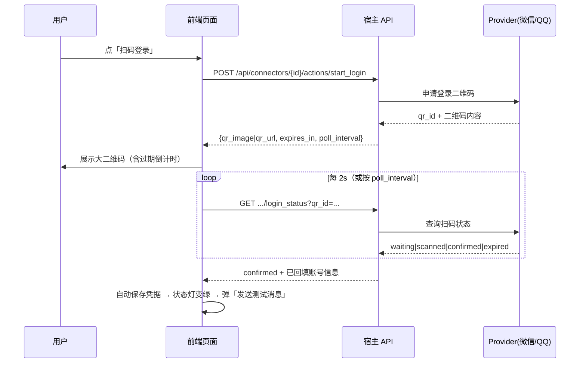

# 07 · Bot 配置页面与交互设计（gateway / aicli / runtime-server / TUI）

> 上游：[03-host-integration.md](./03-host-integration.md) §5（Schema 驱动）、[06-target-architecture.md](./06-target-architecture.md)（定稿架构）
> 本文回答：**各终端有没有配置页面、放哪里、配什么、怎么存、扫码等操作如何做到方便**。

## 1. 设计目标与原则

| 目标 | 量化/验收 |
|------|-----------|
| 最快接入 | Telegram **1 步**（粘贴 token）；微信/QQ **扫码 2 步**；飞书 **2 步**（自动注册 webhook） |
| 字段最少 | 首期每通道 ≤ 4 个凭据字段；其余全部有可work的默认值 |
| 密钥安全 | 写入后**永不回显**（GET 只返回 `secret_keys`）；前端不落 secrets |
| 保存即生效 | 保存触发连接器 `Reload()`，无需重启宿主；失败回滚并给出可操作提示 |
| 三端一致 | 同一份 Schema JSON；控件映射与快照测试；未知字段降级不报错 |
| 操作逻辑可配 | "谁能用 / 在哪聊 / 怎么触发 / 怎么回 / 用什么跑 / 限到什么程度"六类策略可配，且有全局默认 |

**核心原则：凭据（Credentials）与操作逻辑（Policy）分离**——凭据决定"连得上"，策略决定"怎么用"；
策略全部有默认值，用户不动也能跑。

## 2. 信息架构：各终端的落点与定位

| 终端 | 定位 | 页面落点 | 现状 |
|------|------|----------|------|
| **gateway console** | 公网入口 + 多设备管理 + **bot 专用配置域** | 侧栏新增一级导航「**机器人**」`#connectors`（列表/详情/日志） | 无设置页；但有「设备令牌」表单+模态可复用（`cmd/gateway/console/app.js`） |
| **runtime-server（React）** | 服务器部署管理面 | 设置新增「连接器」分区 + 独立页 `/runtime/connectors` | ✅ 已有 settings 体系：`settings-dialog.tsx`、`gateway-settings-page.tsx`（密钥"留空=不改"模式）、`provider-dialog.tsx`（Tab 表单） |
| **aicli 微前端** | 本机 agent 的本地接入 | 页签新增「机器人」`tab-connectors` | ✅ 已有 `tab-config`（`config-admin.js`）与 `provider-editor.js` 表单范式 |
| **aicli TUI** | 应急/最小操作（不做完整表单） | `/bot` 命令：`list / status / enable / disable / qr` | 扫码时打印**登录链接**（在浏览器完成），不渲染二维码 |

> gateway 是唯一同时具备"公网可达 + 常驻"的终端，因此 **webhook 类通道（飞书）的主配置面在 gateway**；
> 微前端/React 更适合配置**本机轮询类通道**（Telegram/QQ/微信）。三端都写同一份 Schema，因此
> "先在 gateway 配好、再复制到本机"是合法路径（见 §5.4）。

## 3. 页面与线框

### 3.1 列表页（三端一致）

```
┌ 机器人 ──────────────────────────────────────────────── [ + 新增 ] ┐
│ ● 微信（vince 个人号）   polling   已启用   2 分钟前活动   [详情] │
│ ● Telegram @my_bot       polling   已启用   刚刚活动       [详情] │
│ ● 飞书（研发群）          webhook   已停用   —             [详情] │
│ ⚠ QQ 机器人              gateway   异常：Token 过期        [修复] │
└────────────────────────────────────────────────────────────────────┘
```
- 状态灯：`已启用/已停用/异常`；异常行内给**修复按钮**（跳转详情并聚焦问题字段）。
- 每行显示：provider、模式（polling/webhook/gateway）、最后活动、近期错误摘要。
- 顶部「+ 新增」→ §3.2 向导。

### 3.2 新建向导（3 步，右侧实时校验）

```
步骤 1 选择通道        步骤 2 凭据              步骤 3 操作逻辑（可跳过）
┌────────┐  ┌────────────────────────┐  ┌──────────────────────────┐
│ 微信   │  │ Bot Token  [________]  │  │ 允许用户：owner（默认）   │
│ QQ     │  │ 模式 (*) polling ( )   │  │ 会话模式：1:1（默认）     │
│ 飞书   │  │        webhook         │  │ 命令前缀：/               │
│Telegram│  │ [测试连接]  校验中… ✅  │  │ 通知偏好：仅高优先（默认）│
└────────┘  └────────────────────────┘  └──────────────────────────┘
```
- 通道卡片只显示该通道需要的字段（来自 Schema）。
- `[测试连接]` 就地验证凭据（Telegram `getMe`、飞书 `tenant_access_token`、微信登录态、QQ token）。
- 微信/QQ 的凭据步骤替换为**扫码**（§3.4）。

### 3.3 详情页（Tab）

```
[概览] [凭据] [绑定与用户] [通知] [日志]
概览：状态灯 / 模式 / 连接自检 / 一键测试消息 / 最近 5 条错误
凭据：字段表单（密钥留空=不改）+ 重新扫码 / 重新授权
绑定与用户：默认会话模式、允许用户白名单（含"生成配对码"）、当前绑定会话列表（可解绑）
通知：哪些事件推送到该会话（高优先必发、低优先可选）、免打扰时段、每用户限速
日志：滚动最近 N 条（方向/摘要/结果），支持按错误过滤
```

### 3.4 扫码登录（微信 / QQ）——最需要"方便"的路径


- **过期自动刷新**：倒计时归零自动调 `start_login` 重新出码，无需用户操作。
- **换账号**：详情页「重新扫码」；旧凭据在新登录成功后才替换（避免中途失效）。
- **无前端场景（TUI）**：`/bot qr wechat` 输出登录链接（或短码），用户用手机打开浏览器完成；完成后
  TUI 轮询到 `confirmed` 并提示。
- **移动端**：二维码按视口放大（≥ 60% 宽度），长按保存/分享；同时给 `qr_url` 便于在另一台设备扫。

### 3.5 webhook 通道（飞书 / Telegram-webhook）

- 保存凭据后宿主**自动注册 webhook**（需要 `--public-base-url`，与推送同源）。
- 详情页展示只读 URL：`https://<public-base-url>/hooks/connectors/<id>` + `[复制]`；若自动注册失败，
  给出平台侧手动配置的分步指引（飞书开放平台路径、Telegram `setWebhook` 命令）。
- 顶部显示**可达性自检**：`最近一次平台回调：2 分钟前 · 200`。

### 3.6 测试与诊断面板

```
[发送测试消息]  → 该通道回一条 "aicli-gateway 测试消息"（10 秒内到达视为成功）
[连接自检]      → token 有效性 / webhook 可达 / 轮询心跳 / 最近错误（分项 ✅⚠❌）
[导出诊断]      → 脱敏 JSON（不含 secrets），供排障
```

## 4. 配置项清单（覆盖"用户操作逻辑"）

### 4.1 凭据层（由 Schema 定义，前端零硬编码）

| 通道 | 字段（首期） | 模式 | 特殊动作 |
|------|--------------|------|----------|
| Telegram | `bot_token`；可选 `proxy_url` | polling / webhook | 测试=`getMe`；webhook 自动注册 |
| 飞书 | `app_id`、`app_secret`；可选 `verification_token` | webhook（可选 WS） | 自动注册 webhook；challenge 自检 |
| QQ | `app_id`、`app_secret`（+ sandbox 开关） | gateway WS | 扫码/授权（可选） |
| 微信 | 由扫码登录产生（`account_id` 等自动回填） | polling | **扫码登录**（§3.4） |

### 4.2 操作逻辑层（策略）

| 类别 | 配置项 | 默认 | 说明 |
|------|--------|------|------|
| 谁能用 | `allowed_users`（平台 openid / uid）、`pairing_code` | 仅 owner | 未授权用户首次提示后静默；支持生成一次性配对码 |
| 在哪聊 | `session_mode`（`chat`=1:1 / `thread`=话题映射） | `chat` | thread 模式为 opt-in（D2） |
| 怎么触发 | `command_prefix`、`mention_required`（群聊） | `/`、群聊必须 @bot | 私聊无需 @ |
| 怎么回 | `reply_mode`（`stream`/`final`）、`typing`、`max_chunk` | 自动按通道能力 | 不支持编辑的通道自动降级 |
| 用什么跑 | `agent.model`、`permission_preset`、`reasoning_effort` | 继承会话/全局默认 | 每连接器可覆盖 |
| 发什么 | `notify_kinds`（approval/question/error/completed…）、`quiet_hours` | 仅高优先 + 合并低优先 | 与 `notify` 中台偏好联动（D6） |
| 限到什么程度 | `user_rate_limit`、`max_concurrent_turns` | 10 msg/min、1 | 超限提示一次后静默 5min |
| 其它 | `auto_title`（新会话标题模板）、`locale` | 首条消息截断、`zh-CN` | — |

### 4.3 继承与覆盖

```
全局默认（宿主级）  →  连接器级（本页）  →  会话级（控制台会话设置里的覆盖）
```
- UI 对未显式设置的字段显示「继承：全局默认（值）」并支持「恢复默认」。
- 全局默认页：gateway console「机器人 → 默认策略」；React「设置 → 连接器 → 默认」；微前端同理（同一 Schema）。

## 5. 配置保存、存储与安全

### 5.1 存储位置（与 [06](../bots/06-target-architecture.md) D8 一致）

| 宿主 | 配置 | 密钥 | 权限 |
|------|------|------|------|
| gateway | `<data-dir>/connectors.json` | 同文件 `secrets` 字段 | 0600 |
| aicli | `~/.aicli/config.yaml` 的 `connectors:` 节（分层合并 + 写锁） | `~/.aicli/connectors.secrets.yaml` | 0600 |
| runtime-server | config document（`/api/runtime/config/document`）扩展 `connectors` 节 | 同目录 `connectors.secrets.yaml` | 0600 |

### 5.2 密钥编辑语义（统一，参照已有 `gateway-settings-page` 模式）

| 操作 | 行为 |
|------|------|
| GET 列表/详情 | 只返回 `secret_keys: ["bot_token", …]`，**不回明文** |
| 编辑时留空 | **保持原值不变**（前端不发送该字段） |
| 输入新值 | 替换 |
| 输入 `__clear__` | 显式清除（UI 提供「清除」按钮，不要求手输魔法值） |

### 5.3 保存流程

```
[保存] → PATCH /api/connectors/{id}
   → 服务端校验（字段必填/枚举/URL）→ 写入存储（0600）
   → connectors.Service.Reload()：启停轮询/WS、重注册 webhook
   → 返回新状态；前端刷新列表与状态灯
   失败：不落盘，返回字段级错误，前端定位到字段
```

### 5.4 导入 / 导出（跨终端迁移）

- **脱敏导出**（默认）：整份配置去掉 `secrets`，用于分享结构。
- **含密钥导出**：二次确认 + 红色提示；导出文件建议用户自行加密保存。
- 三端字段同名，因此"aicli → gateway"迁移=复制文件后调一次保存（或提供「粘贴导入」文本框）。

### 5.5 审计

- 配置新增/修改/删除、扫码登录、启停、测试消息均写 `ConnectorLog`（含操作者与来源 IP）；
- gateway 侧同时写审计（`internal/gateway/audit`，与设备令牌同级）。

## 6. 便捷性设计（"应该很方便"的落点）

| 场景 | 设计 |
|------|------|
| 最短接入 | 列表页「+ 新增」→ 选通道 → 粘贴 token → 保存（Telegram 全程 ≤ 20 秒） |
| 扫码 | 大二维码 + 自动刷新 + 成功后自动回填并弹「测试消息」；TUI 给链接 |
| 复制 | webhook URL、配对码、错误详情均带一键复制 |
| 一键诊断 | 详情页「连接自检」分项 ✅/⚠/❌ 并给修复动作（含平台跳转链接） |
| 失败引导 | 错误文案 = 现象 + 原因 + 动作（例："Token 失效 → 到 @BotFather 重新生成 → 粘贴保存"） |
| 手机操作 | gateway console 响应式（375px 可用）；二维码/表单在移动端优先 |
| 幂等操作 | 重复保存/重复扫码不产生重复连接器；启停有明确确认 |
| 无鼠标 | 向导支持 Tab/Enter 完成（React 端；console 端尽力） |

## 7. 三端一致性护栏

1. **同一 Schema**：`GET /api/connectors/schema`（ETag 缓存）；三端渲染器共用 JSON 快照测试。
2. **控件映射表**（固定）：`text→输入框`、`secret→密码框+留空语义`、`url→URL 校验`、`bool→开关`、
   `enum→下拉`、`qr-action→扫码面板`、`action→按钮`。
3. **未知类型降级**：渲染为文本框并在旁显示原始 key（核心先升级、前端后跟随时不炸）。
4. **契约测试矩阵**：同一组 golden 用例对三宿主 API 断言一致（含脱敏、错误码、actions 流程）。
5. **复用既有组件**（不重造轮子）：
   - React：`settings-dialog` 分区 + `gateway-settings-page` 的密钥语义 + `provider-dialog` 的 Tab 表单；
   - 微前端：`config-admin.js` 表单范式 + `provider-editor.js` 弹窗；
   - console：`app.js` 的 tokens 页表单/模态与 `.panel/.btn/.toast` 样式。

## 8. 与现状的差距与实施顺序

| 项 | 现状 | 动作 | 阶段 |
|----|------|------|------|
| `/api/connectors*` + `/schema` + `actions` | 无 | 新建（契约包 `internal/connectors/api`） | P-1/P0 |
| gateway console「机器人」域 | 无设置页 | 新增视图（复用 tokens 页样式；列表+向导+详情+日志） | P0 |
| React 连接器分区/页面 | 有 settings 体系 | 新增 settings section + `ConnectorDialog`（复用 provider-dialog 模式） | P0/P1 |
| 微前端「机器人」tab | 有 config tab 范式 | 新增 `connectors.js` + tab | P1 |
| TUI `/bot` 最小操作 | 无 | 新增命令（list/status/enable/qr-link） | P1 |
| 扫码 actions（微信/QQ） | 无 | 后端 action 端点 + 三端扫码面板 | P3（微信）/P2（QQ） |
| 全局默认策略页 | 无 | 三端 Settings 子页（同 Schema） | P1 |

## 9. 验收清单

- [ ] Telegram 从「+ 新增」到收到测试消息 ≤ 3 步、≤ 60 秒（三端任一）。
- [ ] 微信/QQ 扫码：过期自动刷新；成功自动回填并引导测试；TUI 可经链接完成。
- [ ] 飞书：保存后自动注册 webhook；详情页可复制 URL 与查看最近回调状态；自动注册失败有手动指引。
- [ ] GET 响应与前端存储中**无明文密钥**（自动化断言）。
- [ ] 策略项全部有默认值；未改任何策略即可完成一次对话。
- [ ] 三端 Schema 快照一致；未知字段类型不导致页面崩溃。
- [ ] 配置变更落审计/日志；导出脱敏/含密钥两条路径均有二次确认。
- [ ] 手机浏览器（375px）可完成：查看列表、启停、扫码、发送测试消息。
