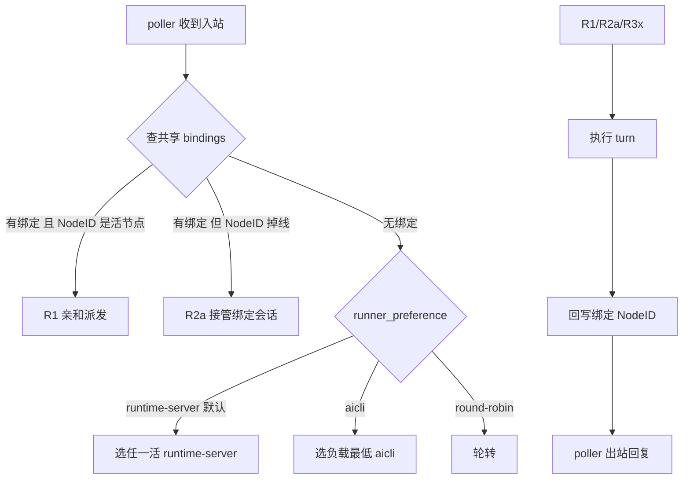

# 09 · Bot 连接器：共享状态、会话绑定与多实例协同（架构定案）

> 上游：[07-config-ux.md](./07-config-ux.md)（配置 UX，§5.6 运行归属）、[06-target-architecture.md](./06-target-architecture.md)（定稿架构）、
> [03-host-integration.md](./03-host-integration.md)（宿主接线）。运行操作与验收矩阵另见
> [08-operations-and-acceptance.md](./08-operations-and-acceptance.md)（本文只定架构，不重复运维口径）。
> 状态：**定案文档**（2026-10-14，D1–D4 已由需求方拍板）；本文是后续切片的唯一需求来源。
> 代码基线：2026-10-14 主干（含当日 config 热同步修复，见 §4.4）。

## 0. 动机（一次真实故障复盘）

2026-10-13 实测暴露的完整链路问题（事件时间线见 git 历史 / `~/.aicli/logs/runtime-server.log`）：

1. 同一微信 bot 在 aicli 里重新扫码后生成了**新的 bot 身份**（`f7571fbe…@im.bot`），
   并在 user 层 config.yaml 创建了第二个连接器 `wechat-mv7axxalc64b`；
2. aicli 与 runtime-server **各持一份 state.json**（bindings/owners 互不可见），
   aicli 进程成为新连接器的 poller，runtime-server 仍轮询旧 bot 账号——
   用户消息发给谁取决于"哪个进程先扫的码"，完全不可预期；
3. runtime-server 侧回复持续报 `model_unavailable`（默认 provider 未随 config.yaml 生效，已另行修复，
   见 `config_document_runtime.go` / `config_snapshot.go` 2026-10-14 变更）；
4. 全程**没有任何 UI/TUI 入口**能看到"bot 绑定了哪个会话、由哪个实例在跑"，也无法改绑。

结论：bot 与普通通知渠道不同——它**双向**（收 IM 输入 + 作通知出口），当前架构在
"配置共享 / 状态共享 / 绑定管理 / 多实例"四个面上都缺一块。本文逐一定案。

## 1. 设计目标与非目标

| 目标 | 验收口径 |
|------|----------|
| 单一配置源 | aicli / runtime-server 对同一份分层合并 config.yaml 读写，provider/连接器改动 ~5s 双端生效（已达成，固化） |
| 单一状态源 | bindings/cursors/claimed/owners **一份** state，两宿主同读同写 |
| 连接与绑定分离 | bot 实体稳定存在；会话绑定可创建/切换/解除，旧会话上下文不丢 |
| 双端对等管理 | runtime-server 页面左栏 + aicli TUI `/bots` 均可管理绑定 |
| 多实例正确性 | 有绑定→亲和执行；无绑定→优先 runtime-server；抢占不破坏绑定 |
| 凭据与实体两层 | 重新扫码=替换凭据；创建新 bot=显式动作 |
| 通知接收可控 | bot 可配置接收事件类通知（含其它会话），默认关闭、类型白名单、范围可选（D5） |

**非目标（v1）**：跨机器共享 state（走文件系统）；远程 runner 的流式增量回传；
单 bot 多账号池。

## 2. 定案记录（Decision Records）

| # | 决策 | 内容 |
|---|------|------|
| **D1** | 状态真源 | **在 aicli / runtime-server 内统一解析代码与逻辑**：state 路径由共享函数推导（锚定用户级 `~/.aicli`），两宿主**禁止**各自按 configPath 推导出不同文件；禁止出现第二份配置文件语义 |
| **D2** | 无绑定时的 runner 选举 | 引入 `connectors.runner_preference: runtime-server(default) | aicli | round-robin`；无绑定的入站默认交给任一 runtime-server 节点执行 |
| **D3** | 接管语义 | 接管时**先核对"当前运行会话 == 绑定会话"**：一致→接管该绑定会话（亲和转移，绑定不动）；无绑定→**不迁移任何绑定**，接管处理器按共享绑定表现状处理（未绑定的 chat 走 auto-create） |
| **D4** | 实体与凭据两层 | **重新扫码=替换登录凭据**（作用于既有 bot 实体）；**创建新 bot=显式动作**（独立入口/确认）。任何 provider（微信/QQ/…）的扫码流程都必须服从该两层模型，杜绝"扫码即新建连接器" |
| **D5** | 通知接收开关 | 连接器级 `policy.notify{enabled,kinds,scope}`：bot 是否接收事件类通知（含**其它会话**的 turn 结束/审批/提问等 hook）。默认关闭；kinds 白名单对齐 `AttentionKind*`；scope 二值（绑定会话/宿主全部）。详见 §7.4.1 |
| **D6** | 连接器级模型路由 | `policy.route{provider,model,reasoning_effort}`：bot 配置了路由即覆盖全局默认（**仅对新回合生效**；已绑定会话不迁移，上下文保持）。零值回落宿主默认；实现为回合级 `RunRouteOverride`（与 team 任务路由同通道，复用 `chat.SubmitPromptOption.RouteOverride`） |

## 3. 架构总览：三个平面

```
┌─ 控制面（共享，已就绪）────────────────────────────────────────┐
│ config.yaml 分层合并（AICLI_CONFIG_MERGE=on）                   │
│   连接器定义 / provider / runner_preference / 策略              │
│   写路径：PUT /api/runtime/config/document + 外部文件轮询        │
└──────────────────────────────────────────────────────────────┘
┌─ 数据面（共享，本文 D1 核心）─────────────────────────────────┐
│ connectors state（唯一一份）：                                  │
│   bindings: (connectorID, chat) → SessionRef{NodeID,SessionID} │
│   cursors / claimed(幂等) / owners(poller 归属+心跳)            │
│   路径：~/.aicli/data/connectors/state.json（共享解析函数推导） │
└──────────────────────────────────────────────────────────────┘
┌─ 执行面（每实例本地）────────────────────────────────────────┐
│ runtimeManager 快照 + actor/hub + LLMRuntime + provider 实例    │
│ runtime-server 与 aicli 各持一份，通过 mesh/绑定 NodeID 协同    │
└──────────────────────────────────────────────────────────────┘
```

两个正交角色（多实例协同的基石）：

| 角色 | 职责 | 唯一性 | 机制 |
|------|------|--------|------|
| **Poller**（收发体） | getupdates/WS 拉取、出站发送（持有 provider 凭据与 `context_token` 缓存） | 每 connector 全局一个 | 现有 owners 账本（30s 心跳 / 90s stale / takeover）**原样保留** |
| **Runner**（执行体） | 执行 agent turn（会话上下文所在实例） | 按会话亲和 | `SessionRef.NodeID` + mesh 派发（P2） |

## 4. D1：状态真源统一

### 4.1 现状断裂（代码锚点）

两宿主用的是**同一套推导算法**（`<configPath 所在目录>/data/connectors/state.json`），
但输入 configPath 落在**不同的分层**，结果必然分叉——这正是"共享算法不够，必须统一输入锚点"的原因：

| 宿主 | 推导代码锚点 | 解析到的 configPath（分层合并 on 时） | 实际 state 文件 |
|------|--------------|----------------------------------------|-----------------|
| runtime-server | `cmd/runtime-server/connector_bootstrap.go: runtimeConnectorStatePath(configPath)`（当前实现按 configDir 推导） | 项目层 `backend/.aicli/config.yaml` | `backend/.aicli/data/connectors/state.json` |
| aicli | `cmd/aicli/commands/connector_host.go`（同口径 configDir 推导） | 用户层 `C:\<user>\.aicli\config.yaml` | `~/.aicli/data/connectors/state.json` |

（分层合并只统一了"读到的**配置内容**"，不统一"state 写到哪个目录"——因为 state 路径
跟随的是**单文件路径**而非合并结果，这是 2026-10-13 Fix-S4 注释"与 aicli 同源"失效的根因。）

两份文件 ⇒ 绑定互不可见、通知反查失败、归属信息割裂（§0 复盘的第 2 条）。

### 4.2 统一方案

1. **共享解析函数**（新增，`internal/connectors/statepath`）：

   ```go
   // CanonicalStatePath 返回 connectors 共享状态的唯一路径。
   // 规则：<用户主目录>/.aicli/data/connectors/state.json。用户主目录取
   // os.UserHomeDir()（与 aicli 分层栈的兜底一致；agentconfig 现仅有测试缝
   // UserHomeDirForTest，生产无注入点——本包不引入新的 home 覆盖机制）。
   // 显式覆盖仅允许环境变量 AICLI_CONNECTORS_STATE（测试/容器挂载用）。
   // 两宿主必须经由本函数取路径；禁止任何 configPath 相对推导。
   func CanonicalStatePath() (string, error)
   ```

2. **两宿主接线**：`runtimeConnectorStatePath` / aicli `statePath` 全部改为调用
   `CanonicalStatePath()`；删除"优先随 configPath 推导"分支（其历史注释同步作废）。

3. **一次性迁移**：storejson 打开时若发现**旧位置**（按旧算法可推导出的若干候选）存在
   而规范位置缺失/为空 → 合并迁移（bindings/cursors/claimed/owners 取并集，
   binding 冲突按 `updated_at` 新者胜；owners/claimed 直接并入），旧文件改名 `.bak-<ts>`
   保留，写一条迁移日志。迁移幂等：规范文件已非空则跳过。

4. **并发**：沿用既有 `connectors.lock` 目录锁 + 原子写（storefile 已实现）；
   同机多宿主（runtime-server + N×aicli）在此机制下安全。跨机器不在 v1（见 §10）。

### 4.3 统一后的直接收益

- 任一端创建的绑定，另一端 REST/UI 立即可读（G1 关闭）；
- `NotifySession` 反查绑定不再受"事件发生在哪台"影响（G4 关闭一半，发送端见 §7.4）；
- `claimed` 幂等账本共享 ⇒ 消息重复投递在两宿主间也被去重；
- `owners` 可见 ⇒ 双端列表页都能正确显示/抢占归属（UI 已有 active_owner/抢占按钮）。

### 4.4 基线说明（2026-10-14 已落地的前置修复）

本文定案前，config 侧的分叉已先行修复（与本文不冲突，是其前置）：

| 修复 | 文件 | 内容 |
|------|------|------|
| 启动加载与配置页同源 | `internal/runtimeserver/config_snapshot.go` | `LoadRuntimeAgentConfig` 在合并模式（`AICLI_CONFIG_MERGE`，默认 on）且多层的场景改用 `agentconfig.LoadMergedConfigDocument()` 的合并结果；单层退回单文件 |
| 默认 provider 热生效 | `internal/runtimeserver/config_document_runtime.go`、`internal/llm/runtime.go`、`internal/bootstrap/manager.go`、`cmd/runtime-server/main.go` | `providers.default_provider` 归入 hot_reload；`RuntimeConfigHotReloader.SetPostApplyCallback` 把默认值同步进 live LLMRuntime 与 runtimeManager 快照（actor 回合解析读后者） |

本文 D1 处理的是**数据面**（state.json）的同类分叉；config 面已闭环。

## 5. 连接与绑定分离（绑定面）

### 5.1 数据模型

`connectors.Binding` 已有 `{ConnectorID, Chat, Session(SessionRef{NodeID,SessionID}), UpdatedAt}`；
**不新增表**，只补语义与约束：

| 字段 | 语义 |
|------|------|
| `Session.SessionID` | bot 当前服务的 agent 会话；空=未绑定（进入 auto-create） |
| `Session.NodeID` | Runner 亲和节点（mesh node_id 或宿主身份 `runtime-server` / `aicli:<instance>`）；空=未指定，按 D2 选举 |
| `UpdatedAt` | 绑定最后变更时间；REST 用作乐观锁（`expected_updated_at`） |

`/new` 的既有行为（写入零值 Session 的墓碑绑定）保留：**显式解绑 ≠ 删除记录**，
避免旧会话被 auto-create 重新抓回。

### 5.2 REST 契约（三端共用，挂在现有 `/api/connectors*` 管理面）

```
GET    /api/connectors/bindings?connector_id=&chat=
        → {items:[{connector_id, chat, session_id, node_id, updated_at,
                   connector:{id,name,provider,active_owner,enabled}}]}
PUT    /api/connectors/{id}/bindings/{chat}
        body {session_id, node_id?, expected_updated_at?}
        → 200 BindingView；404 未知连接器；400 会话不存在/字段非法；
          409 expected_updated_at 不匹配；403 allowed_users 未命中
DELETE /api/connectors/{id}/bindings/{chat}
        → 200（写零值墓碑，语义=显式解绑）
```

约束（写入前校验）：
- connector 存在且 enabled；session 存在（本机校验，跨节点 P2 经 mesh 校验）；
- `policy.allowed_users` 非空时 chat 必须命中（与入站白名单同源，aicli fail-closed 不放宽）；
- bind 是**覆盖式指针切换**：旧会话与其上下文原样保留，仅 bot 换指向（满足
  "重新绑定解除当前会话、绑定新会话/新上下文"）；
- 每次变更写 ConnectorLog（system 方向，含变更者来源：api/ui/tui）。

实现约束（与现有代码的对齐点，审查 2026-10-14 核实）：

1. **路由注册顺序**：gorilla/mux 按注册顺序匹配，`GET /connectors/bindings` 必须先于
   `GET /connectors/{id}` 注册（`restapi.NewRouter`，`internal/connectors/restapi/restapi.go:69-80`），
   否则字面量 `bindings` 会被当作 `{id}` 吞掉；
2. **Store 需新增 CAS**：现有 `Store` 只有 `GetBinding/PutBinding/ListBindings`
   （`internal/connectors/store.go:26-35`），无比较交换。乐观锁语义由新接口承载：
   `CompareAndSwapBinding(expected UpdatedAt, next Binding) (Binding, bool, error)`
   —— 锁内读改写，返回 `(新值, 是否命中, 错误)`；**三个实现同步补齐**：
   `MemoryStore`（测试）、`storefile`（`storefile.go:258-308` 已有 bindings 三方法）、
   `storejson`（生产），并进契约测试矩阵；
3. **TUI 不直读文件**：aicli `/bots bind` 走本机 loopback REST（`restapi.NewRouter(deps)`
   经 `setLocalConnectorHandlers` 挂在 aicli mux，`cmd/aicli/commands/connector_host.go:290`；
   TUI 命令经 `LocalConnectorHost` 取宿主，见 `chat_bots_command.go botsResolveHost`），
   与 React 同一套校验；
4. **白名单校验放 restapi 层**：bind/unbind 与入站共用同一 `Policy.AllowedUsers` 判定，
   避免两套口径。

### 5.3 runtime-server UI（N4）

会话页左栏新增「机器人」面板（`workspace` 侧栏，会话列表之下）：

```
机器人
├ 微信（wechat-mv6sq81uf85g）  运行于 runtime-server
│    当前绑定：—                [绑定到当前会话] [扫码换凭据]
├ 微信（wechat-mv7axxalc64b）  运行于 aicli:17328
│    当前绑定：当前会话 ✓       [解绑] [切换到当前会话]
└ …
```

- 数据源：`GET /api/connectors/bindings` + `GET /api/connectors`；
- 操作即 PUT/DELETE；成功后失效本页与 connectors 页缓存；
- 「扫码换凭据」见 §6（两层模型）。

### 5.4 aicli TUI（N5）

```
/bots                     列表：id / provider / enabled / 运行归属 / 绑定摘要
/bots bind <id> [session] 绑定当前（或指定）会话到连接器；chat 取最近活跃 IM 会话
/bots unbind [chat]       解绑
/bots status [id]         连接器详情：归属、心跳、最近绑定、最近错误
```

实现为本地 loopback API 的客户端（与 React 同一套 REST），不直读 state 文件。

## 6. D4：Bot 实体与凭据两层模型

### 6.1 概念模型

```
Bot 实体（Connector）            登录凭据（Credentials）
  id / name / provider             bot_token(secret)
  policy（白名单/命令前缀…）        account_id
  settings.mode / route_tag        owner_user_id
  ───────── 1:N ────────────▶      base_url
  （实体稳定，凭据可换）            （由扫码/平台后台产生，可替换）
```

规则：
1. **重新扫码 = 替换凭据**：作用于用户**已选中**的 bot 实体；成功后按现有
   `login_status` 回填约定 PATCH `settings/secrets`（action-dialog 已实现该回填路径），
   实体 id/name/policy **不变**，绑定**不变**；
2. **创建新 bot = 显式动作**：仅能通过「新增连接器」入口，且提交前明确告知
   "将创建一个新的 bot 实体"；新建实体的首次扫码属于**初始化凭据**；
3. 两层规则对所有 provider 生效（微信/QQ 的 ActionProvider 扫码同约）。

### 6.2 对既有交互的修正

| 入口 | v1 现状 | 修正后 |
|------|---------|--------|
| 列表页「新增连接器」 | 内嵌扫码（先建实体再出码） | 保留，但标题/按钮文案明确"创建新 bot"；若 Schema 有可扫码通道，创建后直接进入初始化扫码 |
| 编辑对话框 | 无扫码入口 | 新增**「重新扫码（替换凭据）」**主按钮 → 复用 ConnectorLoginPanel，回填目标=当前实体；成功后提示"凭据已替换，绑定与会话不受影响" |
| 扫码确认页 | 不显示目标实体 | 显示目标 bot（名称/ID），替换模式额外显示"将覆盖 bot_token/account_id/owner_user_id" |
| 防呆 | 无 | 扫码 confirmed 后若新 `account_id` 与**其它** bot 实体的 account_id 撞车 → 警示"该账号已绑定在连接器 X"并提供跳转（v1 提示即可，不阻止） |

### 6.3 反例约束（回归用例）

- 在编辑对话框扫码成功 ⇒ 该连接器 id 不变、bindings 不变、只换 secrets/settings；
- 新增流程中途取消 ⇒ 清理草稿实体（已实现：未确认关闭即 DELETE）；
- 同一 provider 两个实体指向同一 account_id ⇒ 允许创建但列表页给 ⚠ 标记（poller 归属机制天然保证只有一个在轮询）。

## 7. 多实例协同（D2 / D3）

### 7.1 Poller 侧：机制不变，语义收紧

现有 owners 账本（先到先得 / 心跳 / stale 接管 / takeover API / `policy.runtime_owner` 指定）
继续作为 **poller 唯一性**的裁决机制。D1 之后 owners 共享，双端看到的归属一致，
`/runtime/connectors` 的「抢占」在 aicli 侧同样可见、可发起（aicli 侧经本地 REST）。

### 7.2 Runner 路由决策（入站消息在 poller 节点落地后）



| 分支 | 条件 | 行为 |
|------|------|------|
| **R1** | 绑定存在且 `NodeID` 在 mesh peers 中活跃 | turn 派发到该节点执行（远程 submit，v1 仅终态回传；本机节点直接本地执行） |
| **R2a**（D3 前半） | 绑定存在但 NodeID 掉线 | **先核对"当前运行会话==绑定会话"**：一致 → 由接管节点继续服务该绑定会话（绑定记录不变，仅执行体转移）；成功后更新 `NodeID` 并在 IM 提示一次 |
| **R2b**（D3 后半） | 无绑定 | **不迁移/不新增任何绑定**；接管处理器按共享绑定表现状处理：该 chat 之后的消息走 auto-create（在新节点建会话并按 §5.1 正常落绑定） |
| **R3**（D2） | 无绑定 | 按 `connectors.runner_preference` 选举：默认优先任一活着的 runtime-server；没有则 aicli；`round-robin` 轮转 |

### 7.3 turn 派发契约（P2 定稿占位）

```
POST /api/runtime/connectors/dispatch     （宿主内部，令牌鉴权）
body {connector_id, chat, text, user_id, user_name, message_id,
      session_ref{node_id, session_id}, reply: "final"|"delta"}
resp {reply:[{text}], session{node_id, session_id}, success, error}
```

- v1 远程只回**终态**（流式增量仅本机保留）；
- 幂等：`claimed` 键在 poller 侧已写，派发体携带 `message_id` 供 runner 二次校验；
- 命令回环（`/approve` 等）：派发体带 `is_command`，runner 走既有 `CommandBackend`。

### 7.4 通知方向（bot 作为通知渠道）

注意力事件（approval/question/turn finished）→ 反查**共享** bindings 得到目标 chat 集合 →
**统一由该 connector 的 poller 节点执行发送**（凭据与 `context_token` 都在 poller 侧）。
即：事件可以发生在任何节点，**发送永远收口在 poller**——跨实例通知问题在 D1 + 本条之后闭环。

#### 7.4.1 通知接收开关（D5，2026-10-14 补充定案）

**需求**：bot 与其绑定会话是两回事——同一个 bot 实体还应能接收**其它会话**的事件类
hook/通知（如另一个会话的 turn 结束、审批请求）。是否接收、接收哪些类型，是连接器级
配置，默认**关闭**。**语义分层**：绑定会话的事件通知是既有能力（approval/question
提示与命令回环），不受开关影响；D5 开关只裁决**其它会话**的事件是否也送达——
未配置 = 不收任何跨会话通知（与 2026-10-14 之前的行为一致）。

**配置**（连接器 Policy，随现有 Schema 驱动 UI 渲染，`internal/connectors/types.go Policy`）：

```yaml
connectors:
  - id: wechat-main
    policy:
      # 事件通知开关与类型白名单；缺省（未配置）= 不接收任何事件通知（现状）。
      notify:
        enabled: false            # 总开关：只裁决"其它会话"的事件；绑定会话始终通知
        kinds:                    # 接收的事件类型（AttentionKind 同名值）
          - approval              # 审批请求（可 /approve）
          - question              # 提问（可 /answer）
          - completion            # 会话回合结束（"turn 结束"类）
          - error                 # 回合失败
        # 目标会话范围（二选一，缺省 sessions）：
        #   sessions = 仅"已绑定到本 bot 的会话"（现状语义，防打扰默认）
        #   all      = 宿主内全部会话的事件（广播模式，需显式开启）
        scope: sessions
        # 静默窗口/合并属 notify 中台职责（06 定案），本配置不重复造轮子；
        # kinds 粒度只做第一道过滤。
```

**语义与边界**：

| 项 | 定案 |
|----|------|
| 默认值 | `notify.enabled=false`：绑定会话照常通知（现状），跨会话不收 |
| 现状对齐 | 宿主当前订阅三类事件（approval/question/turn-done，`connector_bootstrap.go:405-437`）+ `AttentionKindError`；kinds 枚举与 `AttentionKind*` 常量同名 |
| 过滤点 | 宿主事件回调映射出 `AttentionNotice{Kind,Session}` 后、入队前逐连接器判定（`Policy.AcceptsNotice`）：**已绑定会话 → 始终收**；未绑定（其它会话）→ `enabled=true` 且 `kinds` 命中且 `scope=all` 才收。任一连接器接收即出站（一个事件可同时命中多个 bot） |
| 命令回环 | approval/question 类通知天然带 `/approve`、`/answer` 提示；**回环回复会路由回该 bot 的绑定会话**（runner 亲和见 §7.2），被通知会话≠绑定会话时命令仍可执行（CommandBackend 按消息里的 request/question id 定位） |
| 发送收口 | 不变：仍由该 connector 的 poller 节点发送（凭据/context_token 在 poller 侧，§7.4） |
| 去重 | 沿用宿主现有事件级去重窗口（`connectorAttentionDeduper`），不按 bot 重复建账 |
| UI/TUI | Schema 驱动：`notify.enabled`(bool)、`notify.kinds`(multi/逗号分隔)、`notify.scope`(enum) 三个字段进 Schema 渲染（connector-dialog 与微前端零改动获取） |
| 安全 | `scope=all` 是广播行为，启用时 ConnectorLog 记 system 告警一条；白名单语义不变（通知不改 IM 准入） |

**P1 实现范围**：`Policy` 增 `Notify` 子结构（enabled/kinds/scope）+ Schema 字段 +
宿主过滤点（runtime-server `subscribeRuntimeConnectorAttention`、aicli 同口径）；跨节点事件
的广播依赖 D1 共享 state，无新增机制。`scope=all` 的跨宿主事件扇出在 P2 随 mesh 派发一起做。

#### 7.4.2 连接器级模型路由（D6，2026-10-14 补充定案）

**需求**：bot 与一般通知渠道不同，是长驻的对话入口——每个 bot 应能配置自己的
默认 provider/model/reasoning effort；配置后覆盖全局默认，让不同的 bot 走不同的
模型（如客服 bot 用便宜模型、私人 bot 用旗舰模型）。

**配置**（连接器 Policy，随 config.yaml 分层生效）：

```yaml
connectors:
  - id: wechat-main
    policy:
      route:
        provider: workbuddy                    # 空 = 全局默认 provider
        model: global:deepseek-v4.1-flash      # 空 = （覆盖后 provider 的）默认模型
        reasoning_effort: medium               # 空 = 会话/全局默认档位
```

**语义与边界**：

| 项 | 定案 |
|----|------|
| 默认值 | 零值（三项全空）= 不覆盖，回落 `runtimeConfig.Agent.Default*`（与 D1 之前的宿主默认同源） |
| 作用范围 | **仅对新回合生效**（回合级 `chat.RunRouteOverride`，与 team 任务路由同一机制）；已绑定会话不迁移——上下文历史保持，仅执行参数变化 |
| 优先级 | 连接器 route > 宿主全局默认；IM 命令 / 会话级显式选择 > 连接器 route（用户在会话内 /model 选择的优先） |
| 落库 | storefile（flow map）/storejson（struct）/restapi `PolicyView.route` 三处持久化；零值不落盘 |
| UI | `/runtime/connectors` 编辑对话框 + 侧栏机器人面板后续接入 route 三字段（P1 前端余项）；config 文档编辑器立即可编辑 |
| 落点 | runtime-server：`BackendRequest.Policy` 携带策略快照 → `ConnectorTurnRequest.Route` → `SubmitConnectorPrompt` 组装 `chat.SubmitPromptOption.RouteOverride`；aicli 宿主同构接线 ✅（2026-10-14：`localConnectorBackend.Handle` 经 `SubmitPromptWithRoute` 传入同一 RunRouteOverride，归一化两宿主共用 `connectors.RouteOverrideFromPolicy`；P2 mesh 派发时对齐 gateway） |

**验证（2026-10-14 真机）**：真实微信连接器配置 `route{workbuddy, global:deepseek-v4.1-flash, medium}`
→ config 保存热生效 → `GET /connectors` 视图回显 route → 轮询重载后归属照常（runtime-server）。
模型调用端到端以 workbuddy 上游可用为前提（上游无响应属 provider 服务问题，与路由机制无关）。

### 7.5 mesh 集成点

| 项 | 说明 |
|----|------|
| peer 记录扩展 | `kind: "aicli" \| "runtime-server"` + `capabilities:["runner","poller"]`；心跳/发现复用现有 mesh 机制。**切片 A ✅（2026-10-14）**：词表常量落 `internal/connectors/hostid.go`（MeshPeerKind*/MeshCapability*）；aicli 网关注册（chat_gateway_host.go REGISTER）与 mesh 档案（mesh_bootstrap.go HostConfig.Capabilities）已带 `runner` 位 |
| runtime-server 入网 | P2 让 runtime-server 以 peer 身份注册（当前 mesh 只有 aicli 节点）。**切片 A 未含**：runtime-server 仍是常量 HostID、未写 node record——入网写档与 endpoint 补写随切片 B（dispatch 端点需要其可达地址）一起做 |
| 节点身份 | `NodeID` = mesh node_id；runtime-server 单机默认 `runtime-server`（与 HostID 同源） |
| 活性判定 | 复用 `GET /web/api/mesh/peers` 的 `session_state/heartbeat`；stale 阈值与 owners 心跳对齐（90s） |

宿主身份现状与目标（2026-10-14 核实）：两宿主当前 `HostID` 是**常量**
（`"aicli"` / `"runtime-server"`，`connector_host.go:252/282`、`connector_bootstrap.go:52/88`），
实例区分仅靠 owners 记录里的 `pid`；同机多 aicli 实例会共享同一 HostID——
**这在纯 poller 归属下是安全的**（归属=pid+心跳），但 P2 的 NodeID 亲和要求实例唯一，
因此目标形态是 `aicli:<mesh-node-id>`（启动期从 mesh 档案取，未入网时退回 `aicli:<pid>`）。
D1/绑定 API（P1）不依赖该改造。

**切片 A 落地（2026-10-14）**：
- **宿主身份双字段**：`internal/connectors/hostid.go` —— `HostID = <kind>[:<instance>]`
  实例唯一 + `HostKindOf`/`HostMatchesPolicy`（policy.runtime_owner 准入**按
  HostKind 匹配**：裸词与 `kind:instance` 都命中，存量 `runtime_owner: aicli`
  配置零改动兼容——这是 HostID 实例化不炸归属闸的关键）。
  service.go 认领/接管两处改用 HostMatchesPolicy。
- **aicli HostID 实例化**：`aicli:<mesh-node-id>`（mesh.Current 取，跨重连稳定、
  同机多 TUI 唯一），mesh 不可用退回 `aicli:pid-<pid>`（进程唯一，重启换新，
  与归属陈旧接管语义一致）。
- **runtime-server / gateway**：单进程部署即唯一实例，裸 kind HostID 已满足
  目标形态（不改值，仅注释标注）。
- 归属账本 owners 的 Owner 值自此为实例唯一 id（P2 NodeID 亲和的判定键就绪）。

### 7.6 故障矩阵

| 故障 | 恢复 | 绑定影响 |
|------|------|----------|
| poller 崩溃 | 90s 后任一宿主按现有规则接管；游标在共享 state，续传不丢消息 | 无 |
| runner 崩溃（有绑定） | R2a：接管节点继续该绑定会话 | 不变（仅 NodeID 更新） |
| runner 崩溃（无绑定） | R2b：不迁移；后续消息 auto-create | 无 |
| 双宿主同时写 state | 目录锁 + 原子写（既有）+ REST 乐观锁 | — |
| runtime-server 全灭 | poller 归属可被 aicli 抢占；无绑定流量按 D2 落到 aicli | 无 |

## 8. 安全与准入

- runner 侧执行前**重查**本机生效的 `policy.allowed_users`（aicli fail-closed 语义不放宽）；
- 远程派发走宿主内部令牌（与 skills 管理面同源；aicli 侧沿用 ChatWebAuthGuard）；
- 绑定 API 同样校验白名单：不能通过 bind 绕过入站准入；
- ConnectorLog 记录 bind/unbind/takeover/派发（操作者 + 来源）。

## 9. 实施地图

| # | 差距 | 涉及文件 | 期 |
|---|------|----------|----|
| 1 | `CanonicalStatePath` + 两宿主接线 + 迁移 | `internal/connectors/statepath`(新)、`cmd/runtime-server/connector_bootstrap.go`、`cmd/aicli/commands/connector_host.go`、`storejson` 打开迁移 | P1 |
| 2 | bindings REST（含 CAS/校验/审计） | `internal/connectors/restapi`（bindings.go 新增）、`storejson`、契约 golden | P1 |
| 3 | UI 左栏 bot 面板 | `frontend/src/components/workspace/*`、`api/runtime/connectors.ts` | P1 |
| 4 | TUI `/bots` | `cmd/aicli/commands/chat_bots_*.go`（新） | P1 |
| 5 | 「重新扫码=替换凭据」入口 + 文案 + 防呆 | `connector-dialog.tsx`/`login-panel.tsx`、i18n | P1 |
| 6 | `runner_preference` 配置键 + 解析 | `internal/connectors/runner_preference.go`（词表/归一化/R3 选举纯逻辑 PickRunnerForUnbound）、storefile `connectors.runner_preference` / storejson `runner_preference` 读写、restapi `GET/PUT /connectors/runner-preference`（能力接口 RunnerPreferenceStore，未实现存储 501）；✅ 2026-10-14（选举器在 P2 mesh turn 派发接线时真正消费） | P1 |
| 7 | `policy.notify{enabled,kinds,scope}`（D5）+ 宿主过滤点 | `internal/connectors/types.go`（Policy）、Schema 导出、`internal/connectors/attention.go`（共享订阅/过滤/出站，三宿主单一实现点）；runtime-server ✅ / aicli ✅（connector_host 经 host.EventBus 接入）/ gateway ✅（OnSessionTransition 投影 hook，AttentionNoticeForProjection 映射） | P1 |
| 8 | mesh peer kind 扩展 + runtime-server 入网 | mesh 包、`cmd/runtime-server` | P2 |
| 9 | turn 派发端点 + `service.go` 路由决策（R1/R2/R3） | **✅ 2026-10-14（切片 B 全量）**：决策层 `internal/connectors/dispatch.go`（DecideRoute + RunnerPlane 能力接口）；接收面 restapi `POST /connectors/dispatch`（Runner 未装配 501/缺必填 400/失败 502）；执行面 runtime-server `runtimeConnectorRunner`（SubmitConnectorPrompt + 命令回环走 ConnectorDecideApproval/AnswerQuestion）、aicli `localConnectorRunner`（Handle 复用 + DecideApproval/AnswerQuestion）；发起面 `Deps.Peers`（mesh 档案 BuildView 装配，kind/state/endpoint 过滤）+ `Deps.RemoteDispatch`（POST 对端 BaseURL，X-AICLI-Token 档案令牌，DispatchCallTimeout 180s）；runtime-server 入网（读档案视角）就绪，self 档案写入待补（当前以 readers 身份可见 aicli peers） | P2 |
| 10 | 注意力发送收口 poller + `scope=all` 跨宿主扇出 | `cmd/runtime-server/connector_bootstrap.go`、mesh 派发 | P2 |

P1 交付后即可解决 §0 的全部四类事故；P2 让"绑定的会话在哪台就在哪台跑"成为事实。

## 10. 遗留开放问题

1. **跨机器共享 state**：v1 限定同机（文件锁安全域）。跨机走 P2 mesh 派发时，
   state 仍按机一份 + bindings 经 API 同步，还是共享网络盘？（倾向前者：以
   poller 节点的 state 为该 connector 的权威副本）
2. **远程流式**：IM 侧流式增量是否值得跨节点中继（P3 评估，当前远程仅终态）；
3. **账号池**：一个 bot 实体多账号轮询（明确非 v1）；
4. **runner_preference 生效范围**：全局一键 vs 每 connector 覆盖（当前定案为全局键，
   预留 per-connector `policy.runner_preference` 覆盖位）。

## 11. 验收清单

- [ ] D1：runtime-server 与 aicli 的 `state.json` 为同一物理文件（含迁移路径单测）；
- [ ] N1：aicli 新建连接器 → runtime-server 列表立即可见并可接管（反之亦然）；
- [ ] N2：aicli 产生的绑定在 runtime-server `GET /bindings` 可读；删除后双端一致；
- [ ] N3：bind 切换目标会话后，旧会话历史完好；unbind 后新消息走 auto-create；
- [ ] N4：左栏面板可完成 绑定/解绑/切换，白名单外 chat 被拒绝并提示；
- [ ] N5：`/bots bind|unbind|status` 与 REST 行为一致（同一套校验）；
- [ ] N6：三条路由用例（R1/R2/R3）各有集成测试；杀 poller/runner 均可自愈；
- [ ] N7：非 poller 节点产生的 approval 事件能送达 IM；
- [ ] N8：aicli fail-closed 白名单在远程 runner 上同样生效（测试覆盖）；
- [ ] D4：编辑对话框扫码后 connector id/bindings 不变；新增流程取消即清理；
- [ ] D5：`notify.enabled` 缺省（未配置）时行为与现状一致（不收任何事件通知）；
      kinds 白名单逐类过滤有测试；`scope=sessions` 只收绑定到本 bot 的会话事件，
      `scope=all` 收宿主全部会话事件并记 system 告警；
- [ ] 回归：`go test ./internal/connectors/... ./internal/runtimeserver/... ./cmd/runtime-server/...` 全绿；
      前端 `npm run lint && npm test` 全绿。
