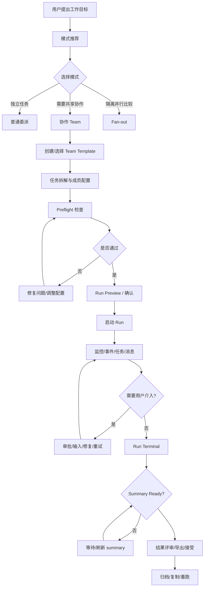

# Team 产品完整度检查与优化建议

- **日期**：2026-11-22
- **基线文档**：`team-product-closure-and-usage-plan-20261122.md`
- **目的**：对现有 Team 产品闭环方案进行二次审查，重点检查用户使用、Web 前端嵌入、aicli TUI、Runtime API、生命周期、可观测性与验收落地方面仍不清晰或不足的部分。
- **结论类型**：本文分为“基线文档已明确的现状/缺口”与“进一步审查建议”。未进行代码仓库或实际运行验证，不能把建议当成已实现事实。

---

## 1. 总体结论

Team 的主要短板并非缺少底层运行机制，而是**产品概念、入口、状态生命周期、用户操作、结果收敛与跨入口一致性尚未形成统一产品契约**。

基线文档已覆盖创建 Team、roster、session binding、task graph、routing、wait、mailbox、outcome、Web Fan-out、验收与测试等方面。但仍建议把当前方案从“功能点补齐列表”升级成“Team 产品设计规范”，明确：

1. Team 用户对象模型：Team、Run、Teammate、Worker Session、Task、Attempt、Outcome、Event 的边界。
2. 端到端用户旅程：从模式选择、创建、配置、预检、运行、监督、恢复、结果收敛到归档。
3. 统一生命周期与状态转换：哪些状态是 Team 状态、Task 状态、Session 状态、观察状态，哪些操作允许执行。
4. TUI 使用契约：自然语言如何触发 Team、工具如何顺序使用、交互期间如何处理等待、恢复和用户介入。
5. Web 产品闭环：不仅是 Team Details + Fan-out，还需要创建/编辑/启动/监督/恢复/结果/历史/权限等真正可用的控制面。
6. 嵌入式使用方式：Team 是否可嵌入 Chat、Workspace、IDE、任务详情等不同宿主；嵌入面如何复用组件、状态和权限。
7. 失败处理与可恢复性：错误分类、重试策略、幂等、partial success、cancel、stale session、owner/lease、网络中断。
8. 用户理解和成本透明：何时推荐 Team，运行预估成本/时延，执行实际 route，团队成员配置复杂度及风险提示。
9. 可观测性：Team Run 与 task attempt 的统一时间线、事件 cursor、日志/产物、route audit、成本与质量。
10. 产品验收标准：功能完成之外，验证用户是否能独立完成任务、是否误解状态，以及不同入口是否一致。

**建议优先级：先建立统一契约和完整生命周期，再做 Web Builder；随后完善 TUI 交互与嵌入式体验，最后扩展实时、历史、成本与治理能力。**

---

## 2. 当前方案的优势与不足

### 2.1 已有方案的优势

基线方案已经明确了以下重要事项：

- 后端 Team Runtime 与前端功能之间存在差距，不能因 API 存在就认定产品完成。
- 明确区分普通 subagent、单 Team 多成员协作、独立并行任务、Fan-out。
- Web 不能自行实现 orchestrator、claim、依赖调度或终态判定。
- worker roster 与实际可执行 session 是不同概念，需要 readiness。
- route preview 和实际 route audit 不能混为一谈。
- `team_wait` timeout 不等于 Team 失败；terminal 也不一定 summary ready。
- Web 最小闭环优先于实时 SSE。
- task-level outcome、mailbox、events、path claims、summary 应可追踪。
- 有 P0/P1/P2、测试策略和验收目标。

### 2.2 仍需深化的关键问题

| 领域 | 当前方案的不足/待澄清 | 风险 |
|---|---|---|
| 用户概念 | Team、Team Run、Team 模板、历史运行之间的关系未定义 | 用户不知道“创建 Team”是创建长期团队还是一次运行 |
| Team 生命周期 | 状态较多，但状态归属与合法转换未形成一张权威状态图 | UI 各自映射状态，按钮误操作 |
| Run 生命周期 | Team 是否可重复运行、run 是否独立、旧 task 是否复用未明确 | 历史任务与新运行混淆 |
| 创建流程 | 7 步向导过于偏工程配置，缺少简单模式和高级模式 | 新用户配置负担高 |
| Teammate | profile、capabilities、session、可执行性、权限之间的关系不够产品化 | roster 看起来可用但无法执行 |
| Task | task schema 很完整，但用户输入流程、模板、校验与任务拆解辅助不足 | 用户必须理解大量字段 |
| Task graph | 有表单建议，但缺少图编辑、依赖可视化、错误修复和自动布局要求 | 复杂依赖难以操作 |
| Routing | route preview 仅被描述为复用 API，缺少批量预览、route变化解释、成本估算 | 用户无法理解任务为何选择某 route |
| Run 控制 | start/pause/resume/retry/cancel 等动作列出，但具体语义、支持条件、确认规则未明确 | 状态不一致或误取消 |
| TUI | 偏“自然语言示例”，缺少可复用的操作模式、交互反馈、命令帮助和恢复 UX | TUI 用户依赖模型临时推理 |
| Web | 当前 Web 缺少 Team Builder，但目标设计仍偏静态页面/表单 | 创建与运行闭环不够明确 |
| 嵌入 | “前端嵌入”未单独定义产品形态、组件契约、host context、权限与数据传递 | Workspace/Chat/IDE 多次实现 |
| 实时性 | Polling 的 cursor、退避、错误、停止条件有提及，但没有统一事件消费契约 | 重复事件、遗漏、资源浪费 |
| 结果 | summary 与 task outcome 的关系、汇总质量和 artifact 结构未充分定义 | 结果难以追溯、难复用 |
| 失败恢复 | retry、reclaim、replan 等存在 API 表面，但恢复向导和失败分型不足 | 用户只能自行诊断 |
| 安全/权限 | workspace 权限、write path policy、工具权限、消息权限、成员权限的产品化不足 | Team 可能拥有用户未预期的执行权限 |
| 历史与归档 | Team Directory 与 Run History 的区别、搜索/筛选/归档/删除策略未明确 | Team 数量增长后难以管理 |
| 运营指标 | 成本、token、耗时、成功率、retry、fallback、质量评价未形成指标体系 | Team 成本和质量无法评估 |
| 验收 | 现有验收多偏功能正确性，缺少产品可用性、跨入口一致性、错误恢复与性能门槛 | “功能存在”但体验仍不完整 |

---

## 3. 先统一产品对象模型

建议将产品对象模型明确为以下层次，不要让“Team”同时指配置、运行实例和执行结果。

```text
Team Definition / Template（可复用配置）
    ├─ Team settings
    ├─ Teammate profiles / roles
    └─ Default task patterns

Team Run（一次实际执行）
    ├─ Run status / lifecycle
    ├─ Run config snapshot
    ├─ Teammate runtime bindings
    ├─ Task Graph
    │    └─ Task
    │         ├─ Attempt(s)
    │         ├─ Route Audit
    │         ├─ Outcome
    │         └─ Artifacts
    ├─ Events
    ├─ Mailbox
    ├─ Path Claims
    └─ Final Summary
```

### 3.1 对象职责

| 对象 | 产品含义 | 建议生命周期 |
|---|---|---|
| Team Definition | 可复用的协作配置/模板，不等于执行 | draft → saved → archived |
| Team Run | 对一次目标的实际协作运行 | created → preflight → running → waiting/blocked → terminal → summary-ready |
| Teammate | Team 内的逻辑协作角色 | configured → provisioned → ready → busy → idle/blocked/offline → retired |
| Worker Session | 执行容器/会话绑定 | unbound → provisioning → ready → busy → stale/offline → rebound |
| Task | Team run 中的工作项 | draft → queued → ready → claimed → running → waiting/blocked → succeeded/failed/cancelled |
| Attempt | task 的一次执行尝试 | started → running → completed/failed/aborted |
| Outcome | Task 的结构化交付结果 | submitted → accepted/rejected/needs-review |
| Artifact | 文件、报告、diff、测试结果等 | generated → validated → retained/expired |

**关键建议：Team Definition 与 Team Run 应在 UI 和 API 语义上分离。** 即使当前数据库暂时复用同一个 Team record，也应在产品层提供“配置/模板”和“运行实例”概念，避免后续历史、重跑、复制和归档能力被模型限制。

### 3.2 必须回答的产品决策

- Team 是可长期保存的成员配置，还是一次执行任务后即终止的临时对象？
- 同一个 Team 能否创建多个 Run？
- Run 是否对配置进行 snapshot，旧 Run 是否会因模板变更而被影响？
- Run 是否支持从上次结果继续，还是每次重跑都创建全新 task graph？
- 运行历史是否包含成员绑定、route、task、attempt、artifact、cost 的完整 snapshot？
- 删除 Team Definition 是否影响历史 Run？
- Team Template、Run、Fan-out batch 的命名与导航关系是什么？

建议默认原则：**配置可复用，运行不可变 snapshot，历史可独立查看；复制/重跑产生新 Run，不直接覆盖旧结果。**

---

## 4. Team 用户旅程需要从“功能列表”改为完整闭环

建议统一用户流程：



### 4.1 用户在每一步应获得的信息

| 阶段 | 用户需要知道 | 用户可操作 |
|---|---|---|
| 模式选择 | 为什么推荐 Team；与普通委派/Fan-out 的区别 | 切换模式、查看对比 |
| Goal 输入 | Team 将要解决什么问题、成功标准 | 编辑目标、约束、上下文 |
| 成员配置 | 成员职责、能力、session readiness、权限 | 增删/编辑/绑定成员 |
| Task graph | 工作拆分、依赖、负责人、交付物 | 编辑、重排、连接依赖 |
| Preflight | 具体阻塞项、警告、修复建议 | 一键修复/跳转修改 |
| Run preview | task数量、成员数量、route、风险、预算估计 | 确认启动、返回修改 |
| Running | 正在做什么、下一步、等待原因、进度可信度 | 查看详情、消息、暂停、取消 |
| Intervention | 需要谁/用户做什么、为什么阻塞 | 输入、批准、重新分配 |
| Results | 成功/失败/部分完成、产物、attempt、summary | 接受、导出、重试、补充任务 |
| History | 历史Run、配置快照、运行成本与状态 | 查看、复制配置、重跑、归档 |

---

## 5. Web 前端：建议打造 Team Studio，而不只是详情面板

### 5.1 页面结构建议

```text
Workspace
└─ Teams
   ├─ Overview / Directory
   ├─ Templates
   ├─ Runs
   ├─ Fan-out
   └─ Team Studio
        ├─ Setup
        ├─ Members
        ├─ Tasks
        ├─ Route & Budget
        ├─ Preflight
        ├─ Run Monitor
        └─ Results
```

第一版可不全部拆成独立页面，但导航语义应清晰：

- **Teams**：协作配置/团队目录；
- **Runs**：实际运行历史；
- **Fan-out**：多个隔离运行批量派发；
- **Team Studio**：创建和配置协作 Team 的主工作区；
- **Run Monitor**：执行观察与介入；
- **Results**：任务结果和最终总结。

### 5.2 Team Builder：采用渐进式复杂度

不建议首次创建时展示全部字段。设计三层配置：

**Quick Start（默认）**
- Goal；
- 成功标准/期望交付；
- 选择模板或推荐角色；
- 自动拆解任务；
- 自动配置 routing（可查看）；
- 自动 provisioning；
- Preflight → Start。

**Guided（引导）**
- teammate 数量与职责；
- task list / dependencies；
- read/write scope；
- deliverables；
- difficulty/task type；
- routing preview。

**Advanced（高级）**
- teammate IDs/profile/capabilities；
- session binding；
- max teammates / max writers；
- task metadata；
- strategy；
- route source / fallback；
- path claims / concurrency；
- API payload 和诊断信息。

### 5.3 推荐 Team 模板

模板应可修改、可复制，不要成为硬编码执行策略。

建议首批模板：

| 模板 | 默认角色 | 典型 Task Graph |
|---|---|---|
| Research & Synthesis | Researcher ×2、Synthesizer | 并行研究 → 汇总 |
| Review → Fix → Verify | Reviewer、Implementer、Verifier | review → implement → verify |
| Multi-file Implementation | Planner、Worker ×N、Integrator、Tester | plan → parallel work → integrate → test |
| Architecture Review | Security、Reliability、Maintainability、Lead | 并行评审 → 汇总风险 |
| Data Investigation | Analyst、Query Reviewer、Reporter | gather → validate → report |
| Debug & RCA | Investigator、Hypothesis Tester、Verifier | hypothesis → evidence → verify |
| Documentation | Writer、Technical Reviewer | draft → review → final |

模板启动前应展示：
- 会创建多少 teammate；
- 预计 task 数；
- 哪些 task 并行、哪些依赖；
- 默认 read/write scope；
- 可能的成本与时延等级；
- 哪些权限需要确认。

### 5.4 Task Graph Editor

MVP 使用表格/列表编辑即可，但应支持：

- 创建、编辑、删除 task；
- assignee 下拉选择；
- dependency picker；
- 依赖关系图；
- read/write paths；
- deliverables；
- difficulty、task type、priority；
- task goal 和 inputs；
- 自动布局；
- 验证循环依赖；
- 检查未知 assignee；
- 检查同一路径的写冲突；
- 将 blocked reason 关联到 graph 节点；
- task 复制/拆分/合并（可后期）。

**推荐交互**：
左侧 Task list + 中间 Graph + 右侧 Task inspector。小屏幕降级为 task list + 详情 drawer。不要在第一期要求用户使用复杂画布拖拽。

### 5.5 Preflight（启动前检查）必须成为独立能力

Preflight 不只是按钮前的 validation，而是一个可解释的启动检查报告。

分级：

- **Blocker**：无法安全或有效启动；
- **Warning**：可启动但存在风险；
- **Info**：提醒或默认行为说明。

检查项建议：

| 类别 | 检查 | 示例 |
|---|---|---|
| Team | team ID、run config、limits | 成员数量超过 max_teammates |
| Members | session binding、readiness、profile | session missing / stale |
| Tasks | goal、ID、assignee | assignee 不存在 |
| Graph | dependency、cycle | task 自依赖、环 |
| Paths | write scope、claim conflict | 多 writer 修改同一目录 |
| Routing | route availability、fallback | route 使用 fallback |
| Permissions | workspace access、write policy | task 写路径越权 |
| Budget | tokens/cost/time limit | 超预算或无预算限制 |
| Context | input size、引用/文件可读性 | task context 过大 |
| Runtime | provider health、worker availability | provider unavailable |
| Safety | destructive operation confirmation | 执行高影响修改 |

Preflight 的每个问题都应有：
- 描述；
- 影响；
- 证据/具体对象；
- 建议；
- “跳转修复”操作；
- 修复后重新检查。

---

## 6. Web Run Monitor：把“状态面板”升级为“执行控制中心”

### 6.1 监控首页信息结构

```text
Run Header
  ├─ Run status / elapsed / last update
  ├─ Pause / Resume / Cancel (根据状态与后端能力)
  └─ Health / cost / warnings

Progress
  ├─ Task graph
  ├─ Task counters
  └─ Current bottleneck

Activity
  ├─ Event timeline
  ├─ Teammate activity
  └─ Mailbox / handoffs

Task detail
  ├─ Task state
  ├─ Attempt history
  ├─ Route audit
  ├─ Output / artifact
  ├─ Block reason
  └─ Retry / reassign / unblock actions

Summary
  ├─ Final summary state
  ├─ Findings / decisions
  ├─ Deliverables
  └─ unresolved issues
```

### 6.2 Team Overview 与 Task Graph

Overview 不能只显示“x/y tasks completed”。建议同时显示：

- 总任务数与各状态计数；
- 进度按完成 task 计算，但说明这是 task progress，不是 token/工作量百分比；
- 当前 critical path / 阻塞 task；
- 依赖链；
- active teammate；
- 最近活动；
- failed / blocked task；
- summary readiness。

### 6.3 Task Detail 必须以 Attempt 为中心

Task 是长期工作单元，Attempt 是一次执行。建议 task detail 具备：

- task description、inputs、deliverables；
- current status、assignee；
- attempt timeline；
- 每次 attempt 的 provider/model/reasoning route audit；
- fallback / warnings；
- output / artifact；
- error category + raw error expandable；
- retry/reclaim/replan history；
- message handoff；
- task-level cost/latency（如 runtime 可提供）。

避免仅覆盖“最新 attempt”，否则用户无法解释 retry 前后的行为。

### 6.4 运行状态与操作矩阵

先定义 API 的合法转换，再映射 UI。建议建立状态操作表：

| 当前状态 | 操作 | 预期结果 | 必须显示的提示 |
|---|---|---|---|
| draft/ready | Start | 创建/激活 Run | preflight 与启动确认 |
| running | Pause | 停止新任务调度，正在执行任务的策略需明确 | 当前 task 是否继续 |
| paused | Resume | 恢复 reconcile/scheduler | 将恢复哪些任务 |
| running/blocked | Retry task | 新 attempt | 失败原因、是否复用输入 |
| running | Replan | 重新计算未完成 task graph | graph diff |
| running/blocked | Cancel Run | 受控终止/停止派发 | 影响范围、确认 |
| terminal | Retry failed | 创建新 attempt 或新 run（明确） | 保留旧结果 |
| terminal | Run again | 创建新 Run snapshot | config source |

**注意**：pause/cancel 等语义不能只凭 UI 推断。若当前后端尚无严格支持，UI 应隐藏或 disabled 并解释，而不是制造操作按钮。

---

## 7. TUI：从“自然语言能用”到“可预测、可发现、可恢复”

基线方案对 TUI 描述较多依赖自然语言触发 Team 工具。建议进一步完善以下内容。

### 7.1 TUI 使用模式

至少支持三种使用方式：

1. **自然语言主路径**：用户描述目标、协作要求，模型自动选择 Team 工具。
2. **命令辅助路径**：提供 Team 状态、帮助、历史、诊断等明确命令。
3. **工具级高级路径**：可查看/编辑 Team task spec、route doctor、ID、事件 cursor 等诊断信息。

自然语言不应是唯一入口。用户需要能查询：“当前 Team 在做什么？”“哪个任务卡住了？”“重新等待”“查看结果”“发送消息给某成员”。

### 7.2 建议 TUI 命令（产品设计，不代表当前已存在）

命令名称应根据现有 CLI 命名规范最终定稿；以下为能力建议：

```text
/team help
/team status
/team list
/team show <team-id>
/team tasks
/team graph
/team events
/team mailbox
/team summary
/team wait [duration]
/team retry <task-id>
/team resume
/team cancel
/team route
```

若不希望引入 `/team` 命令，也应提供 equivalent slash help / tool discoverability / built-in shortcuts，不能仅靠用户记忆自然语言。

### 7.3 TUI 交互过程的统一反馈

`team_spawn` 之后立即展示结构化摘要：

- Team ID（复制）；
- run 状态；
- teammate roster；
- session readiness；
- task graph；
- 当前 routing preview/audit（若已解析）；
- warnings/blockers；
- 下一步动作。

`team_wait` 期间：
- 显示“正在等待 Team 更新”，而不是阻塞式无反馈；
- 显示等待时间与最近 event；
- timeout 明确提示“观察窗口结束，Team 是否仍运行”；
- 保留 `latest_seq`，自动支持继续观察；
- 允许用户在等待期间执行其它工作（若产品交互支持）；
- 结束时自动展示 task outcomes 与 summary readiness。

### 7.4 TUI 的状态呈现建议

```text
TEAM: refactor-config
Status: RUNNING  |  2/5 tasks completed  |  elapsed 03:24

Members
✓ reviewer      idle / ready
● implementer   working: task-02
○ verifier     waiting for dependency

Tasks
✓ task-01 review
● task-02 implement
○ task-03 verify (depends on task-02)
! task-04 docs (blocked)

Recent
09:42 reviewer completed review
09:43 implementer started task-02

Next: 2 tasks are waiting. Team is still running.
```

符号与颜色必须配合文字，不可只用颜色传递状态。状态面板在窄终端中应降级为纯文本/简洁列表。

### 7.5 TUI 工具调用策略

建议在 system/tool instructions 或运行时提示中建立稳定行为：

- 模式判定先于 spawn；
- Team 必须先创建/启动，再使用 Team-only tools；
- `team_spawn` 返回 Team ID 后，所有后续调用必须使用该 ID；
- wait timeout 不是失败，不允许自动把 Team 终止；
- `team_wait` 返回 `latest_seq` 时后续观察沿用 cursor；
- task outcome 应用结构化 report/block/handoff 工具，不仅依赖自由文本；
- Team terminal 后仍要检查 summary readiness；
- task failed/blocked 时先分析原因，再决定 retry/replan，避免无条件重试；
- retry 前告知用户可能产生额外调用/成本；
- TUI 输出必须保留结果，不只保留最后一条 assistant message。

### 7.6 TUI 帮助与教学

首次使用或 `/help team` 应提供：
- 何时用 Team；
- 与 subagent 的区别；
- Fan-out 的区别；
- 最简示例；
- task graph 示例；
- 如何等待/恢复；
- timeout 与 failure 的区别；
- 如何查看结果；
- 诊断 route/session 的命令。

---

## 8. 前端嵌入：定义“Team Embedded Experience”

如果 Team 要被嵌入 Workspace Chat、项目页面、IDE、任务详情或未来其它 host，建议避免每个 host 复制 Team UI。建立**Team UI shell + host adapters**。

### 8.1 组件层级

```text
TeamExperience
├─ TeamEntry / ModeSelector
├─ TeamBuilder
│  ├─ GoalEditor
│  ├─ TemplatePicker
│  ├─ MemberEditor
│  ├─ TaskGraphEditor
│  ├─ RoutePreview
│  └─ PreflightPanel
├─ TeamRunMonitor
│  ├─ RunHeader
│  ├─ TaskGraph
│  ├─ ActivityTimeline
│  ├─ MemberStatus
│  ├─ Mailbox
│  └─ TaskInspector
├─ TeamResults
└─ TeamHistory
```

### 8.2 Host Context 契约

不同宿主需要向嵌入组件传递明确 context：

| Host Context | 需要提供 | Team UI 不应假设 |
|---|---|---|
| Workspace | workspace ID、权限、文件树、route config | 不假设默认可写整个 workspace |
| Chat | lead session、conversation context、active run | 不伪造 lead session |
| IDE | active project、当前文件、selection、编辑状态 | 不假设用户同意修改所有文件 |
| Project page | project ID、branch、repository status | 不假设 branch/commit 状态 |
| Standalone | 用户权限、默认 workspace、runtime capability | 不假设存在当前 Chat session |

建议统一一个 Host Context 类型，并版本化。嵌入 UI 应在 context 缺失时给出明确降级状态。

### 8.3 Embedding 交互契约

需要设计：
- 组件如何打开 Team Builder；
- Team Run 如何通过 URL/route 被定位；
- 关闭 drawer/modal 是否影响 run；
- host 退出或切换 workspace 时如何处理 active run；
- Team run 是否支持 detached/background；
- host refresh 后如何恢复当前 run；
- selected task、tab、event cursor 如何持久化；
- event subscriptions/polling 如何注册和清理；
- host 与 Team UI 的权限边界；
- UI 是否可独立部署/加载；
- theme、density、responsive、keyboard navigation。

**建议原则**：运行生命周期不绑定 UI 组件生命周期。关闭 modal、切换页面或刷新浏览器不得意外取消 Team Run。

### 8.4 Embed API / Facade 建议

前端嵌入层只调用稳定 facade，不直接分散调用底层 API：

```ts
interface TeamHostContext {
  workspaceId?: string;
  leadSessionId?: string;
  projectId?: string;
  capabilities: {
    canCreateTeam: boolean;
    canProvisionWorker: boolean;
    canWrite: boolean;
    canCancelRun: boolean;
  };
}

interface TeamExperienceProps {
  host: TeamHostContext;
  mode: "builder" | "monitor" | "results" | "compact";
  teamId?: string;
  runId?: string;
  onRunCreated?: (runId: string) => void;
  onNavigate?: (destination: TeamNavigationTarget) => void;
}
```

以上仅为概念接口，需结合现有前端框架、API client 和 auth/session 模型调整。不要把权限决策放在 props 里并视为安全保证；后端必须授权。

### 8.5 嵌入式视图建议

| View | 适用 host | 用途 |
|---|---|---|
| Compact Run Card | Chat / project panel | 快速查看状态、进度、summary |
| Team Builder | Workspace | 创建/配置/预检 |
| Full Run Monitor | Workspace / IDE | 全功能执行监控 |
| Task Inspector | IDE / code review | task、attempt、route、diff、artifact |
| Results View | Chat / workspace | 结果、summary、交付物 |
| Team History | Workspace | 搜索历史、复制配置、重跑 |

### 8.6 嵌入的可访问性和响应式

必须检查：
- keyboard-only navigation；
- screen reader labels；
- focus management（dialog、drawer、task inspector）；
- color contrast；
- reduced motion；
- narrow width layout；
- high-density TUI/web consistency；
- loading、empty、error、offline states；
- event feed 的可读性和避免频繁跳动。

---

## 9. Runtime API 与统一契约建议

### 9.1 API 需要按产品操作组织

不要仅按 REST endpoint 的存在判断闭环。建议按 capability inventory：

| Capability | API/UI 是否完整 | 设计要求 |
|---|---|---|
| Create draft | 需核对 | 幂等/校验/默认值 |
| Save config | 需核对 | version/snapshot |
| Provision members | 需核对 | readiness、错误回滚/partial |
| Create tasks | 需核对 | batch validation |
| Preflight | 建议统一 endpoint/service | 结构化 blocker/warning |
| Start run | 需核对 | idempotency key、状态转换 |
| Observe | 需核对 | cursor、snapshot、events |
| Pause/resume | 需核对 | 受控 transition |
| Retry task | 需核对 | attempt history、retry policy |
| Replan | 需核对 | graph diff、确认 |
| Cancel | 需核对 | cancel semantics、terminal state |
| Summary | 需核对 | summary status/version |
| Results/artifacts | 需核对 | artifact metadata/retention |
| History | 需核对 | pagination/search |
| Archive | 建议 | soft archive |
| Clone/re-run | 建议 | new run from snapshot |

### 9.2 API 统一错误结构

建议错误 envelope：

```json
{
  "error": {
    "code": "TEAM_PREFLIGHT_SESSION_NOT_READY",
    "message": "A teammate session is not ready.",
    "category": "preflight",
    "retryable": false,
    "details": {
      "teammate_id": "verifier",
      "reason": "session_missing"
    },
    "actions": [
      {
        "type": "rebind_session",
        "label": "Bind a worker session"
      }
    ],
    "request_id": "..."
  }
}
```

UI 不应解析通用 message 文本来决定流程。error code、retryability、details、action hints 需要稳定。

### 9.3 幂等和并发操作

至少需要明确：
- 创建 Team/Run 的 idempotency key；
- Start 重复点击/网络重试不会启动重复 Run；
- Retry task 是否创建新 Attempt；
- Replan 是否需要 optimistic concurrency/version；
- PATCH Team/task 是否带 version/ETag；
- cancel 与 retry 同时发生的冲突如何处理；
- partial provisioning 失败时如何回滚或保留可修复状态；
- API timeout 后用户可通过 run ID 查询真实结果，而不是盲目重新创建。

### 9.4 Snapshot 与配置变更

建议 Run snapshot 包含：
- Team settings；
- teammate profiles/capabilities；
- session binding 来源（必要时不暴露敏感 ID）；
- task graph；
- routing config/version；
- context input references；
- permissions/write scopes；
- budget/limits；
- creation source（TUI/Web/API/template/fan-out）。

运行中修改配置应区分：
- 不影响当前 run 的配置变更；
- 明确支持的 live update；
- 需要 replan 的变更；
- 禁止变更（immutable fields）。

---

## 10. Task、Outcome、Artifact：结果需要可复用，而不仅是 Summary

### 10.1 结构化 Outcome

建议 outcome schema 至少具备：

```json
{
  "status": "succeeded | failed | blocked | handoff | needs_review",
  "summary": "Short result",
  "deliverables": [
    {
      "type": "file | report | diff | test_result | link",
      "name": "artifact name",
      "uri": "artifact reference",
      "description": "..."
    }
  ],
  "changed_paths": [],
  "evidence": [],
  "risks": [],
  "next_actions": [],
  "confidence": "low | medium | high"
}
```

具体 schema 必须以已有 `team_task_outcome_contract.md` 为基线核对后决定，不应在没有审查该契约的情况下另造冲突字段。以上为产品层建议结构。

### 10.2 Outcome Acceptance

建议将“worker 完成”与“用户接受结果”分开：

```text
Task execution complete
    → Outcome submitted
        → Lead/Verifier review
            → Accepted / Needs revision / Rejected
```

并非所有 task 都需要人工批准。根据 task risk/profile 设置：
- Auto-accept；
- Lead review；
- User approval；
- Verifier required。

### 10.3 Artifact UX

交付物应提供：
- 文件名、类型、大小、来源 task；
- artifact preview；
- download/open；
- changed path；
- 是否已验证；
- retention policy；
- artifact 版本；
- retry 后新 artifact 与旧 artifact 的关系。

对于代码修改任务，至少应能关联 diff、测试结果、changed paths、commit/branch（如果 runtime 能提供）。

### 10.4 Summary 的责任

Final Summary 应回答：
1. 目标是否完成；
2. 哪些 task 完成、失败、blocked；
3. 关键发现/决策；
4. 产物与位置；
5. 验证结果；
6. 风险和未解决问题；
7. 是否需要用户后续行动。

Summary 生成状态必须明确：`not_requested / pending / generating / ready / failed / stale`（建议状态，需与现有契约对齐）。Summary 应带 source task/outcome references，避免摘要无法追溯。

---

## 11. Failure & Recovery：建立标准恢复工作流

### 11.1 失败分类

建议错误 taxonomy：

| 类别 | 例子 | 默认恢复策略 |
|---|---|---|
| Configuration | 无效 task、未知 assignee | 修复配置，不自动 retry |
| Provisioning | worker/session 创建失败 | 重试 provisioning 或重新绑定 |
| Provider | provider 过载、不可用 | health-aware fallback/延迟 retry |
| Execution | task 执行异常 | 根据错误类型决定 retry |
| Dependency | upstream failed/blocked | replan 或人工介入 |
| Conflict | write path claim 冲突 | 调整路径/顺序/owner |
| Context | 文件缺失、上下文超限 | 精简/补充输入 |
| Permission | 读写拒绝 | 用户确认/调整授权 |
| Runtime | actor/lease/worker offline | reclaim/rebind |
| Network | API polling timeout | 查询 Run state，不能重复创建 |
| Summary | summary generation failed | 独立 retry summary |

### 11.2 Recovery Wizard

每个 failed/blocked 状态展示：
- **发生了什么**；
- **是否影响整个 Run**；
- **是否可以自动恢复**；
- **恢复可能带来的额外成本**；
- **推荐下一步**；
- **可执行操作**；
- **恢复后状态与历史记录**。

### 11.3 Retry policy

Retry 不能只有一个按钮。建议支持：
- retry task；
- retry with modified inputs；
- retry from failed dependency；
- retry provisioning；
- retry summary；
- retry all failed tasks（需确认）；
- clone run and retry（新 Run）。

自动 retry 应有最大次数、退避、错误白名单、成本限制；所有 retry 都记录 Attempt，不覆盖之前的失败。

---

## 12. Routing、预算与用户透明度

### 12.1 Routing Preview

Preview 需回答：
- route source；
- provider/model/reasoning；

- difficulty 与来源；
- task type/profile 影响；
- fallback candidates；
- warning；
- preview timestamp；
- route policy version。

### 12.2 Preview 与实际执行差异

Run Monitor 每个 attempt 应展示：
- preview route；
- actual route；
- route changed?；
- change reason；
- health fallback；
- retry 是否改变 route。

实际 attempt audit 是事实，preview 是预估。

### 12.3 Budget & Cost

建议增加 Team Run budget controls（如果底层 usage/cost 数据可提供）：

- max token/cost budget；
- soft warning threshold；
- hard stop / pause threshold；
- per-task budget；
- per-attempt budget；
- max concurrent workers；
- max duration；
- user-visible estimated vs actual cost；
- usage breakdown by task/teammate/provider/model。

若无法可靠估算 cost，显示“无法预估/仅提供 token 统计”，不要虚构金额。预算的 hard stop 必须由 Runtime enforcement，不能只在前端显示。

### 12.4 Cost/Latency trade-off

模式选择和 Run preview 可显示简化提示：
- lightweight / standard / high-effort；
- expected latency range（有历史数据时）；
- estimated cost range（有数据时）；
- “estimate not guaranteed”；
- concurrency impacts。

---

## 13. 权限、隐私和安全边界

基线文档提及 workspace access、write path、permission warning，但建议把权限做成 Team Run 的正式产品能力。

### 13.1 Permission model

区分：
- 用户能创建/运行 Team；
- 用户能 provision worker；
- worker 能访问哪些文件；
- worker 能写哪些路径；
- worker 能使用哪些 tools；
- worker 能发送哪些外部请求；
- task 是否需要 approval；
- lead 是否可以将任务分配给其他 teammate；
- mailbox 是否允许所有成员互相可见。

### 13.2 Least Privilege 默认值

建议默认：
- 只读 task 默认 read-only；
- writer 明确 write paths；
- 不允许隐式扩大写权限；
- task 修改权限需要 preflight 检查；
- destructive action 需要用户确认；
- Team Run snapshot 记录 permission scope；
- permission changes 产生审计事件。

### 13.3 Prompt/Context Boundaries

Team task context 中需要明确：
- 用户指令与文件内容的优先级；
- 文件/网页内容是数据，不是可信指令；
- team message、task inputs、tool outputs 的来源；
- context sharing scope；
- sensitive data 的展示与保存策略。

---

## 14. Observability & Analytics

### 14.1 Team Run 的统一事件模型

建议标准事件至少包括：

```text
team.created
team.preflight.started
team.preflight.completed
team.run.started
team.paused
team.resumed
team.cancel_requested
team.terminal
team.summary.started
team.summary.ready
team.summary.failed

teammate.provisioning
teammate.ready
teammate.busy
teammate.offline
teammate.rebound

task.created
task.ready
task.claimed
task.started
task.waiting
task.blocked
task.completed
task.failed
task.retry_requested
task.replanned

attempt.started
attempt.route_resolved
attempt.fallback
attempt.completed
attempt.failed

mailbox.sent
mailbox.delivered
mailbox.acknowledged

artifact.created
artifact.validated
artifact.accepted
```

每个 event 建议带：
- event ID；
- team/run/task/teammate/attempt IDs；
- timestamp；
- sequence/cursor；
- source；
- actor；
- structured payload；
- correlation/request ID。

### 14.2 Dashboard 指标

产品与工程运营可监控：

- Team run success rate；

- task success rate；
；
- blocked rate；
；
- average run duration；
；
- time to first task；
；
- time waiting on dependencies；
；
- retry rate；
；
- provider fallback rate；
；
- session provisioning success rate；
；
- summary generation success rate；
；
- cost per run/task；
；
- user intervention rate；
；
- cancellation rate；
；
- artifact delivery rate。

### 14.3 Polling → Streaming

第一阶段：
- snapshot + cursor polling；
；
- exponential backoff；
；
- jitter；
；
- visibility-aware polling（页面不可见降低频率）；
；
- terminal 后停止高频刷新；
；
- summary pending 低频 refresh；
；
- network error 不覆盖 last-known-good state；
；
- 事件去重。

后续：
- SSE 或 WebSocket；
；
- event replay；
；
- cursor reconnect；
；
- reconnect backoff；
；
- snapshot/event consistency。

不要把 SSE 作为 Builder MVP 的阻塞项，但要预留 event contract。

---

## 15. Team History、Templates、Clone 与 Run Again

基线方案的目录和 Fan-out 之外，建议新增产品化历史能力：

### 15.1 Team Directory

筛选：
- Team name/ID；
；
- workspace；
；
- owner；
；
- template；
；
- archived；
；
- last run status；
；
- updated date。

### 15.2 Run History

每个 Run 保留：
- goal；
；
- config snapshot；
；
- member roster/session binding snapshot；
；
- task graph snapshot；
；
- attempts；
；
- actual routes；
；
- events；
；
- mailbox（按权限）；
；
- outcomes/artifacts；
；
- summary；
；
- usage/cost；
；
- cancellation/terminal reason。

### 15.3 Clone / Run Again

操作语义：
- **Clone config**：复制 Team Definition，不启动；
- **Run again**：用 snapshot 创建新的 Run；
- **Retry failed tasks**：在当前 Run 允许的生命周期内新建 attempts；
- **Continue run**：仅在 runtime 支持的可恢复状态中继续，不等同于重新执行全部 task。

按钮命名必须区分，避免 “Retry” 实际上创建全新执行。

---

## 16. 优先级重新排序

建议采用更产品化的 roadmap：

### P0 — 产品契约与最小可用闭环

1. Team / Run / Task / Attempt / Outcome / Artifact 对象边界定义。
2. 普通委派、协作 Team、Fan-out 模式选择 UX。
3. Team Definition 与 Run snapshot 语义。
4. Web Quick Start Builder。
5. Roster/member provisioning + readiness + rebind。
6. Task editor + graph + dependency validation。
7. Preflight blocker/warning report。
8. Start Run + Run Monitor + task outcome/summary。
9. TUI `/help team` 或等价帮助/快捷命令；状态、wait、timeout、summary UX。
10. API error envelope、idempotency、状态转换契约。
11. Run Monitor 关闭/host navigation 不影响后台运行。
12. 跨 Web/TUI 的统一验收。

### P1 — 可靠性、恢复与嵌入

1. Task attempt history。
2. Structured outcome + artifacts。
3. Retry/replan/rebind/recovery workflow。
4. Event cursor/last-known-good/退避 polling。
5. Host Context + Team Experience embedding contract。
6. Compact Run Card、Task Inspector、Results embedding。
7. Mailbox unread/ack 与 task/timeline 联动。
8. route preview vs actual route audit。
9. Permission/read-write scope UX。
10. Run History、clone config、run again。
11. partial provisioning recovery。
12. Budget warning/usage transparency（依数据能力）。

### P2 — 高级运营与实时协作

1. SSE/WebSocket、event replay。
2. Template library、团队模板共享。
3. Fan-out compare/aggregate。
4. Cost/latency/quality analytics。
5. Team archive/retention policy。
6. Team permission/RBAC 与审计。
7. 高规模 task graph UX。
8. Team run search、pagination、batch operations。
9. Human-in-the-loop approval queue。
10. Run-level notifications。

---

## 17. 推荐实施拆分

### Phase A：产品契约（先完成设计，1 个短周期）

交付：
- 对象模型；
- 生命周期状态图；
- 状态转换表；
- API error taxonomy；
- Team vs Run vs Fan-out 术语；
- host context contract；
- event schema；
- 关键用户旅程。

### Phase B：Web Team Quick Start（P0）

交付：
- Team mode selection；
；
- Quick Start Builder；
；
- templates；
；
- roster；
；
- task list/dependency graph；
；
- preflight；
；
- launch；
；
- monitor basic；
；
- results。

### Phase C：TUI 体验闭环（P0/P1）

交付：
- Team help/discoverability；
；
- spawn output summary；
；
- wait progress/cursor continuation；
；
- status/tasks/summary shortcut；
；
- timeout/failure distinction；
；
- retry/recovery prompts。

### Phase D：Embedded Team UI（P1）

交付：
- Team UI shell；
；
- Host Context adapter；
；
- compact card；
；
- full monitor/results view；
；
- lifecycle independent from component mount/unmount；
；
- route/navigation hooks。

### Phase E：Reliability & history（P1）

交付：
- idempotency；
；
- partial provisioning；
；
- retry/replan recovery；
；
- attempt/outcome/artifact audit；
；
- run history/clone/re-run。

### Phase F：Advanced live operations（P2）

交付：
- event streaming；
；
- budgets/cost analytics；
；
- permission approvals；
；
- cross-team comparison；
；
- notifications。

---

## 18. 建议的 UI 信息架构（参考）

### 18.1 Team Directory

```text
Teams
[Create Team] [Fan-out]

Search | Workspace | Status | Owner | Archived

Team name
Members
Last run
Last status
Last updated
Actions: Open / Clone / Archive
```

### 18.2 Team Builder

```text
Step 1 — Goal
What should this collaboration accomplish?
Success criteria / constraints / deliverables

Step 2 — Team
Template / roles / members / session readiness

Step 3 — Tasks
Task list / dependencies / assignment / scope

Step 4 — Run settings
Routing preview / limits / budget / permissions

Step 5 — Preflight
Blockers / warnings / fixes

[Save draft] [Start Run]
```

### 18.3 Run Monitor

```text
RUN: Team name / run ID
Status | elapsed | last update | usage | pause/resume/cancel

Progress
Task Graph | Status counters | blocked reasons

Members
Current activity | readiness | heartbeat

Activity
Timeline | Mailbox | Route fallback

Task Inspector
Task | Attempts | Outcome | Artifacts | Retry

Summary
Pending / Ready / Failed
```

### 18.4 Results

```text
Run outcome
Success / Partial / Failed / Cancelled

Executive Summary
Completed tasks
Failed/blocked tasks
Key findings
Deliverables
Validation
Risk/limitations
Actual route/usage
Next actions

[Export] [Clone config] [Run again] [Archive]
```

---

## 19. 建议新增的验收标准

### 19.1 产品理解

- 首次用户能正确区分独立委派、协作 Team、Fan-out。
- 用户能说明创建的是配置还是运行。
- 用户能理解 Team Run 与 Team Definition 的关系。
- Quick Start 不要求了解 session ID、route resolver 或内部 tool names。

### 19.2 Web Builder

- 用户可从 Goal 创建 Team draft。
- 能选择模板并自定义至少 2 个 teammate。
- 能创建多个 task、指定 assignee 与 dependency。
- 能看到 graph 和 blocker/warning。
- session 未 ready 时有修复路径。
- preflight 可重复运行且结果一致。
- Start Run 重复点击/网络重试不会产生重复执行。
- 启动后 URL 可定位 Run，刷新页面恢复状态。
- 关闭 Builder/Monitor 不影响 run。
- 成功、partial、failed、blocked、cancelled 等结果均有清晰视图。

### 19.3 TUI

- Help 能解释 Team/subagent/Fan-out。
- Team spawn 输出对象摘要与下一步。
- wait timeout 明确说明 observation timeout。
- 能从 cursor 恢复事件观察。
- Team terminal 与 summary pending 区分。
- task failure 不自动等价 Team failure。
- retry/replan 之前展示原因和成本/风险提示。
- Team run 不被普通 child wait 管理。

### 19.4 Embedded

- 同一 Team Experience 可在 Workspace 和至少一个 compact host 复用。
- host context 缺失时 graceful fallback。
- navigation/refresh/unmount 不影响后台执行。
- 权限仍由 backend enforcement。
- theme、responsive、keyboard、loading/empty/error/offline 状态完成测试。
- event subscriptions 在卸载时清理，不丢失后台 Run。

### 19.5 Reliability

- provisioning partial failure 可恢复。
- API timeout 后可查询状态，避免重复创建。
- retry 创建新 attempt 并保留旧 attempt。
- replan 显示 graph diff。
- event cursor reconnect 不重复/遗漏事件（在契约允许范围内）。
- last-known-good state 在 polling error 时保留。
- summary generation failure 可独立重试。
- cancel/pause race condition 有一致结果。

---

## 20. 关键设计决策清单

建议工程进入实现前逐项确认：

- [ ] Team Definition 与 Team Run 是否分离？
- [ ] 一个 Team 是否支持多个 Run？
- [ ] Run snapshot 是否不可变？
- [ ] Run ID 是否作为 Web/TUI/Embed 的核心导航 ID？
- [ ] TUI 是否需要 `/team` 命令，或使用其它 discoverable help？
- [ ] Team Quick Start 是否默认自动拆任务和成员？
- [ ] 是否提供模板？
- [ ] Team Builder 是否允许先保存 draft？
- [ ] Session provisioning 的 owner 是 host/runtime 还是 Team UI？
- [ ] Worker readiness 的定义是什么？
- [ ] Preflight 是否统一 Runtime 服务？
- [ ] Pause/Resume/Cancel 的 backend semantics 是否已验证？
- [ ] Retry/replan 是否区分 attempt 与 new run？
- [ ] Outcome schema 与现有 contract 是否一致？
- [ ] Artifact storage、preview、retention 是否明确？
- [ ] Budget enforcement 在 backend 是否存在？
- [ ] Event schema、cursor、replay contract 是否统一？
- [ ] Embedded Host Context 是否版本化？
- [ ] Auth/RBAC 与 task permission scopes 是否明确？
- [ ] Run history、clone、archive 是否有数据保留策略？
- [ ] Cross-entry consistency tests 是否纳入 CI？

---

## 21. 最终建议

### 立即推进（最重要的 5 项）

1. **定义 Team Definition / Team Run / Task / Attempt / Outcome 的统一模型和状态图。**
2. **Web 增加 Quick Start Team Builder + Preflight + Start Run + Run Monitor + Results，优先实现可创建真实多成员 Team 的闭环。**
3. **TUI 增加 Team discoverability/help/status/wait/recovery 的稳定体验，不仅依赖模型自然语言调用工具。**
4. **设计 Team Embedded Experience/Host Context 契约，确保 Chat、Workspace、IDE 等 host 复用组件而不重复实现。**
5. **建立统一失败恢复、幂等、事件 cursor、task attempt 和结果 artifact 规范。**

### 不建议立即做

- 不要先做大型 drag-and-drop task graph；
- 不要先做 WebSocket/SSE，除非 polling 已证明瓶颈；
- 不要把 provider/model/reasoning 直接设置成 teammate 固定属性；
- 不要将 Fan-out 合并显示成多成员 Team；
- 不要让 UI 自己执行调度、claim、终态判定；
- 不要仅以 API endpoint 数量作为产品完成度；
- 不要在没有 backend enforcement 的情况下提供“预算硬限制”“暂停”“取消”等假控制；
- 不要在 Run 上直接覆盖配置或历史 outcome。

### 产品定义的完成标准

Team 产品真正“完整”应满足：

> 用户能理解何时选择 Team；能在 Web、TUI 或嵌入入口中创建或启动正确的协作单元；能在启动前发现问题；运行中能理解状态、等待、阻塞和失败并采取安全操作；结束后能获得可追踪、可验证、可导出、可复用的结果；刷新、重试、网络中断或切换入口不会导致 Run 失控或重复执行。

这应作为 Team 后续产品、前端和 runtime 工作的共同 Definition of Done。
